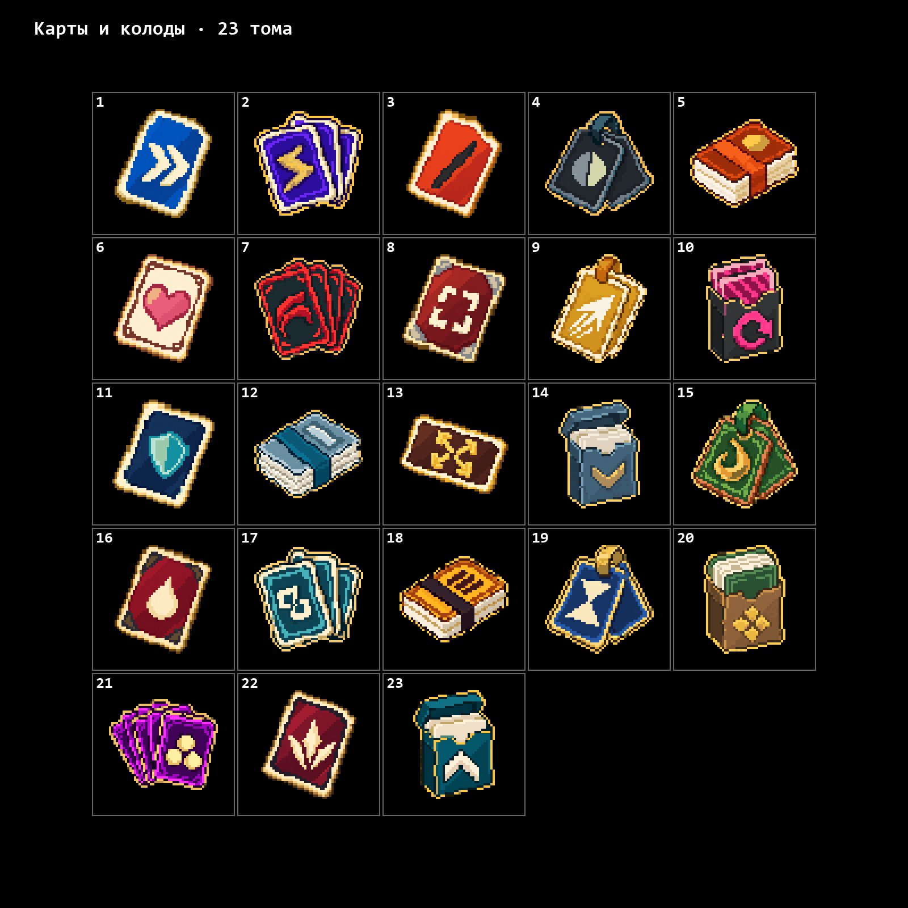
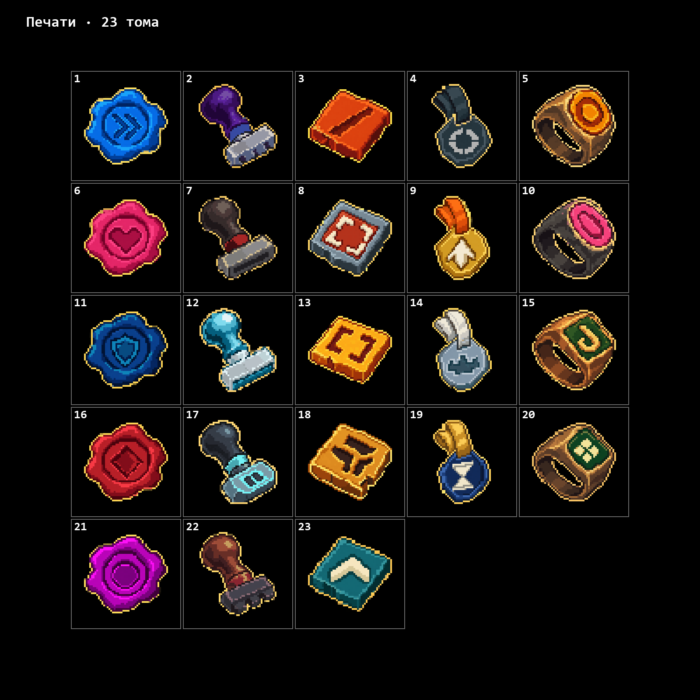

# GameXD · Pixel Icons

Библиотека пиксельных иконок и соответствий **Megabonk → наши ассеты**: 30 оружий, 85 предметов и 23 тома. Для томов подготовлены два самостоятельных варианта — карты и печати.

Подготовлены прозрачные PNG, новые названия на английском и русском, сетки и отдельные карточки сравнения с оригиналами. [Оружие и предметы](assets/review/index.html) и [карты и печати](assets/tomes/dual-sets/index.html) собраны в отдельных предпросмотрах.

| Набор | Статус | Иконки | Предпросмотр |
| --- | --- | ---: | --- |
| `weapons-current` | Основной — актуальный | 30 | [Пушки](assets/review/weapons/preview.html) |
| `items-current` | Основной — актуальный | 85 | [Айтемы](assets/review/items/preview.html) |
| `items-glossy-early` | **Глянец — ранняя версия, архив** | 85 | [Глянцевые айтемы](assets/review/items-glossy-early/preview.html) |

Всего **138 игровых сущностей и 246 вариантов PNG**: 115 актуальных иконок оружия и предметов, 85 ранних глянцевых вариантов и 46 иконок двух вариантов томов. Глянцевый архив отделён от основного набора и подписан во всех предпросмотрах.

## Тома · карты и печати

Все 23 тома получили по две новые иконки с названиями EN/RU. В наборах варьируются одиночные карты, пары, веера и колоды; восковые, каменные, подвесные печати и штампы. Сохранены пиксельная графика, цветная обводка и прозрачный фон. Отдельные PNG имеют размер 256 × 256; подписи и номера находятся только в предпросмотрах. Основной вариант томов пока не выбран.

| Набор | Статус | Иконки | Предпросмотр |
| --- | --- | ---: | --- |
| `tomes-cards-v1` | Альтернативный вариант | 23 | [Карты и колоды](assets/tomes/dual-sets/cards/preview.html) |
| `tomes-seals-v1` | Альтернативный вариант | 23 | [Печати](assets/tomes/dual-sets/seals/preview.html) |

[Сравнение: оригинал → карта → печать](assets/tomes/dual-sets/comparison.html) · [Каталог](assets/tomes/dual-sets/manifest.json) · [Связи по оригинальному названию](assets/tomes/dual-sets/lookup.json)

| Карты и колоды | Печати |
| --- | --- |
|  |  |

Первые 15 поисковых концептов сохранены отдельно: [пять основ](assets/tomes/concepts-01/preview.html) и [первые карты и печати](assets/tomes/cards-seals-01/preview.html).

## Связь с Megabonk

Для **всех 85 айтемов, 30 оружий и 23 томов** сделана связь **оригинал Megabonk → наше название → наша иконка**. Сохранены оригинальное название, новые названия EN/RU, описание исходного эффекта, ссылка на источник и постоянный ID.

Примеры: **Anvil → Triune Gear / Тройная шестерня**, **Sword → Iron Fang / Железный клык**. Актуальная и ранняя глянцевая версии относятся к одному оригиналу; их изображения и исторические названия записаны отдельно.

Соответствия собраны в [общем каталоге](assets/review/manifest.json) и [справочнике оригинальных названий](assets/review/lookup.json). Для спорных описаний источников сохранены примечания.

Для томов один оригинал связан с двумя вариантами: **Agility Tome → Fleet Card / Карта прыти** и **Fleet Seal / Печать прыти**. Оба сохраняют исходный эффект Agility Tome; изображения и названия каждого набора записаны отдельно в [каталоге томов](assets/tomes/dual-sets/manifest.json).

## Структура

- `assets/review/` — предпросмотры, PNG, каталоги JSON/CSV, карточки и листы сравнения.
- `assets/weapon-icons/` — рабочие оружейные ассеты и скачанные оригинальные референсы.
- `assets/items/` — оригиналы, рабочие версии, промпты и сохранённые этапы обработки.
- `assets/tomes/` — оригиналы 23 томов, поисковые концепты и два полных набора карт и печатей.
- `assets/tomes/dual-sets/` — самостоятельный пакет с PNG, предпросмотрами, JSON/CSV и связями с оригиналами.
- `tools/build_tome_dual_sets.py` — сборка и проверка двух вариантов томов.
- `tools/build_asset_review.py` — сборка пакета и проверка ссылок, хешей и разделения версий.
- `tools/build_flat_2d_attempt.py` — сборка отдельных матовых вариантов.

Оригинальные изображения и описания Megabonk: [Megabonk.org](https://megabonk.org/database/items/). Они сохранены как референсы с индивидуальными ссылками на источники.

Источник томов: [Megabonk · Tomes](https://megabonk.org/database/tomes/).
