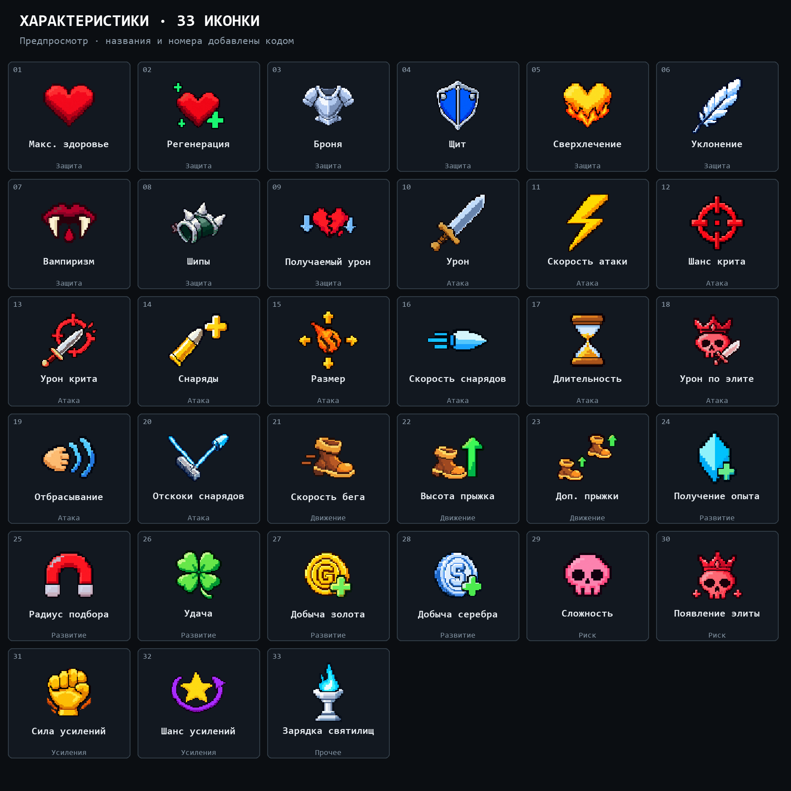
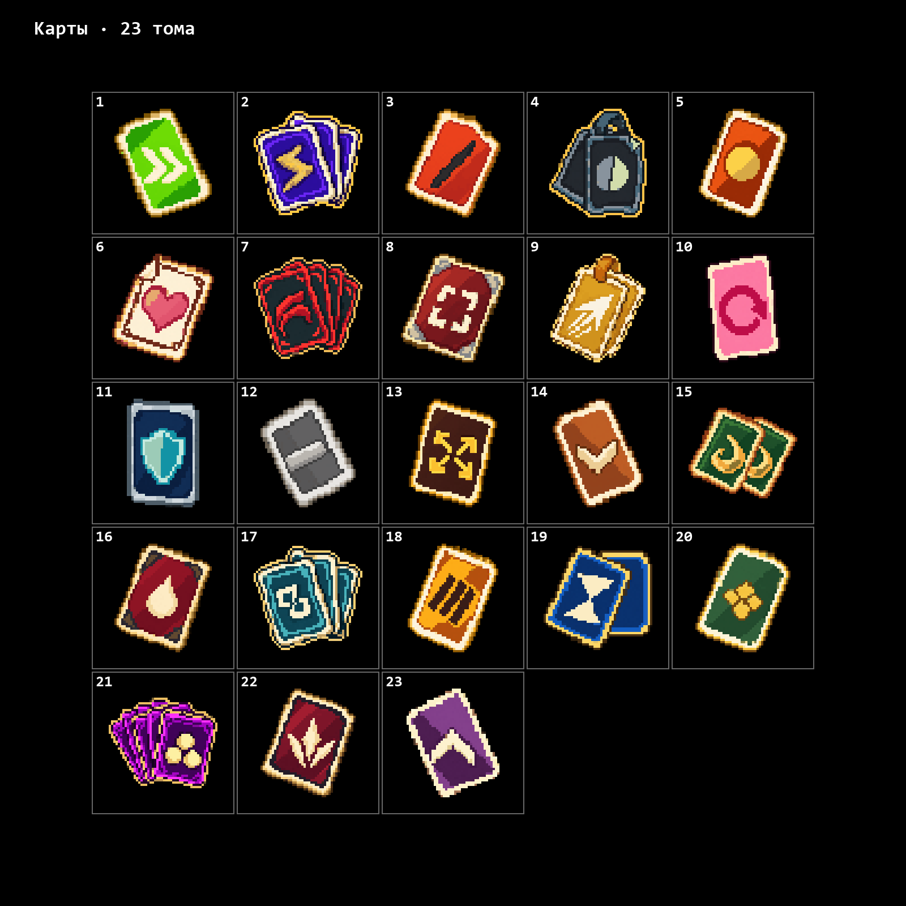

# GameXD · Пушки, айтемы и карты

Пиксельные ассеты для игры: **30 пушек, 85 айтемов, 23 карты и 33 иконки характеристик**.

Для каждого ассета сохранены постоянный ID, название на русском и английском, связь с оригиналом Megabonk и описание исходного эффекта. Иконки подготовлены в PNG с прозрачным фоном.

| Набор | Количество | Предпросмотр | Данные |
| --- | ---: | --- | --- |
| Пушки | 30 | [Смотреть пушки](assets/review/weapons/preview.html) | [Каталог](assets/review/manifest.json) |
| Айтемы | 85 | [Смотреть айтемы](assets/review/items/preview.html) | [Каталог](assets/review/manifest.json) |
| Характеристики | 33 | [Открытый предпросмотр](https://yr4e.github.io/gamexd/stat-icons/) | [Каталог](docs/stat-icons/catalog.json) |
| Карты | 23 | [Смотреть актуальные карты](assets/tomes/cards-authored/cards/preview.html) | [Каталог карт](assets/tomes/cards-authored/manifest.json) |

## Иконки характеристик

**33 актуальные иконки v11** с прозрачным фоном: у каждой есть номер, постоянный ID, ключ и названия на русском и английском.

[Открыть публичную галерею](https://yr4e.github.io/gamexd/stat-icons/) · [Скачать все PNG и каталог](docs/stat-icons/stat-icons-33.zip) · [Список соответствий](docs/stat-icons/README.md)

В галерее доступны поиск по названию, номеру и ключу, фильтры по категориям, просмотр разных размеров и скачивание отдельных PNG.

## Пушки

[Предпросмотр 30 пушек](assets/review/weapons/preview.html) с названиями и соответствиями оригинальному оружию Megabonk.

## Айтемы

[Основной набор из 85 айтемов](assets/review/items/preview.html).

Для **15 позиций** дополнительно подготовлены новые образы: [сравнение оригинала, прежней и новой иконки](assets/items/redesign-distinct-15/preview.html) · [все 85 айтемов с новыми вариантами в общей сетке](assets/items/redesign-distinct-15/context-grid-85.png) · [данные новых вариантов](assets/items/redesign-distinct-15/manifest.json).

Эти 15 вариантов пока собраны отдельно: основной предпросмотр из 85 айтемов содержит прежние изображения этих позиций. Это варианты тех же предметов, поэтому общее количество айтемов — **85**.

## Карты

Актуальный набор — **23 карты `tomes-cards-v3`**. Каждая карта соответствует одному тому Megabonk; ID, порядок и исходные эффекты сохранены.

[Предпросмотр карт](assets/tomes/cards-authored/cards/preview.html) · [Сравнение с оригиналами](assets/tomes/cards-authored/comparison.html) · [Поиск по оригинальному названию](assets/tomes/cards-authored/lookup.json)

## Соответствия оригиналам

Связь для всех трёх категорий: **оригинал Megabonk → наше название → наша иконка**.

- [Каталог пушек и айтемов](assets/review/manifest.json) · [поиск по оригинальному названию](assets/review/lookup.json).
- [Новые варианты 15 айтемов](assets/items/redesign-distinct-15/lookup.json).
- [Каталог актуальных карт](assets/tomes/cards-authored/manifest.json) · [поиск по оригинальному названию](assets/tomes/cards-authored/lookup.json).
