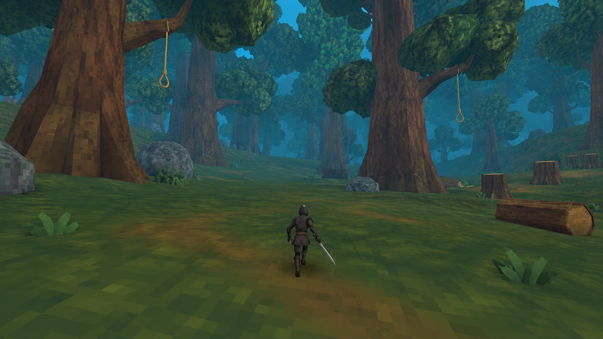
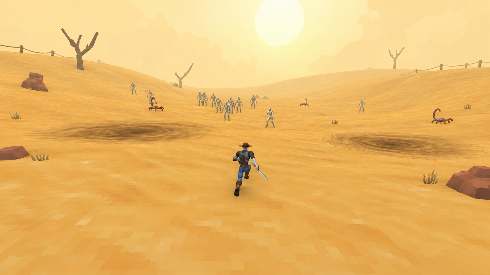
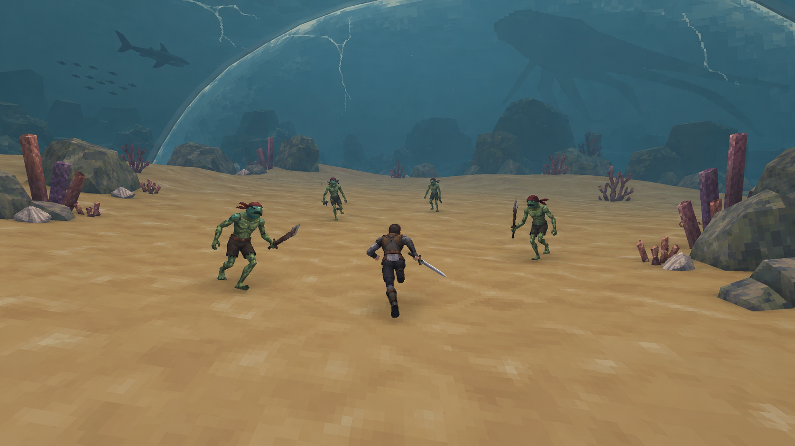
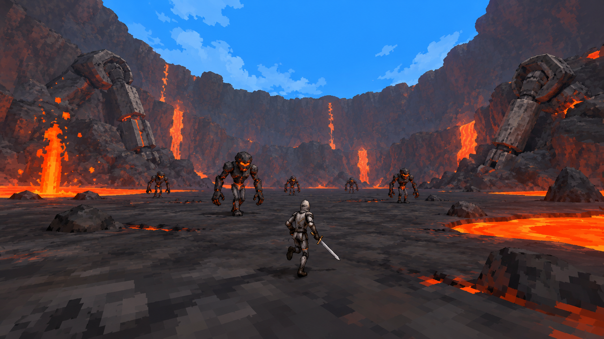
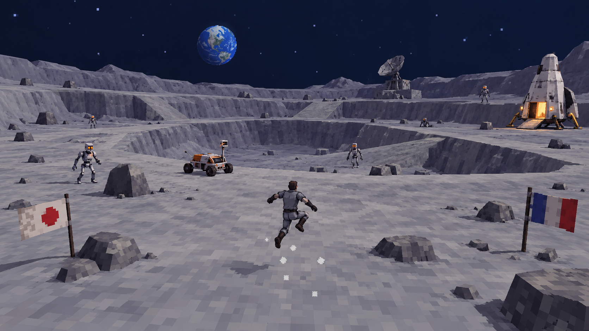

# GameXD · Шесть миров

**Карты, декорации, мобы и боссы в пиксельной 3D-стилистике.** Всё можно посмотреть прямо на GitHub: изображения встроены в страницы, скачивать файлы не нужно.

[Смотреть презентацию в браузере](docs/biomes/slides/README.md) · [Подробное описание всех карт](docs/biomes/CONCEPT-BOOK.md) · [Боссы и переходы](docs/biomes/world.md)

## Порядок прохождения

**Глубокий лес → пустыня → призрачный лес → подводный купол → вулкан → Луна.**

| № | Карта | Особенность |
| --- | --- | --- |
| 01 | [Глубокий лес](docs/biomes/01-forest.md) | Зацепы за верёвки |
| 02 | [Бескрайние пески](docs/biomes/02-desert.md) | Зыбучий грунт |
| 03 | [Призрачный лес](docs/biomes/03-ghost.md) | Дух-усилитель |
| 04 | [Купол на дне](docs/biomes/04-underwater.md) | Разрушение купола |
| 05 | [Вулкан](docs/biomes/05-volcano.md) | Лава и гейзеры |
| 06 | [Луна](docs/biomes/06-moon.md) | Низкая гравитация |

Подводная карта остаётся четвёртой. Вулкан знакомит с расплавленными роботами, а на Луне они встречаются целыми.

## 01. Глубокий лес

Гигантские деревья, широкие поляны и верёвки для смены позиции.

[**Открыть карту: декорации, мобы, взаимодействия и механика**](docs/biomes/01-forest.md) · [Слайды карты](docs/biomes/slides/01-forest.md)

## 02. Бескрайние пески

Открытый горизонт, дюны и зыбучие участки. Без пирамид и построек.

[**Открыть карту: декорации, мобы, взаимодействия и механика**](docs/biomes/02-desert.md) · [Слайды карты](docs/biomes/slides/02-desert.md)

## 03. Призрачный лес

Сосны, паутина, свечи и зелёный туман. Дух усиливает окружающую толпу.

[**Открыть карту: декорации, мобы, взаимодействия и механика**](docs/biomes/03-ghost.md) · [Слайды карты](docs/biomes/slides/03-ghost.md)

## 04. Купол на дне

Бой на сухом морском дне. За куполом плавают рыбы, акулы и огромная тень.

[**Открыть карту: декорации, мобы, взаимодействия и механика**](docs/biomes/04-underwater.md) · [Слайды карты](docs/biomes/slides/04-underwater.md)

## 05. Вулкан

Арена на дне жерла, лава, гейзеры и расплавленные части роботов.

[**Открыть карту: декорации, мобы, взаимодействия и механика**](docs/biomes/05-volcano.md) · [Слайды карты](docs/biomes/slides/05-volcano.md)

## 06. Луна

Кольцевые маршруты кратеров, флаги, шаттлы-шрайны и низкая гравитация.

[**Открыть карту: декорации, мобы, взаимодействия и механика**](docs/biomes/06-moon.md) · [Слайды карты](docs/biomes/slides/06-moon.md)

## Лунный босс

**Две плечевые ракетницы.** Залп заставляет выбирать безопасное место приземления, а перезарядка даёт окно для сближения.

[Все варианты боссов и связи между картами](docs/biomes/world.md)

## Что есть на страницах

- **72 декорации** с названиями.
- **36 мобов** с ролями в бою.
- **36 вариантов интерактивных объектов:** сундук, зарядный шрайн, Moai, сборщик опыта, дубликатор и портал.
- Схемы движения, особенности карт, боссы, границы и переходы.
- **38 слайдов**, доступных как обычные изображения в браузере.

Изображения — концепты для нашей игры. Графический ориентир — Megabonk. Механики биомов и варианты боссов описаны как предложения для разработки.
