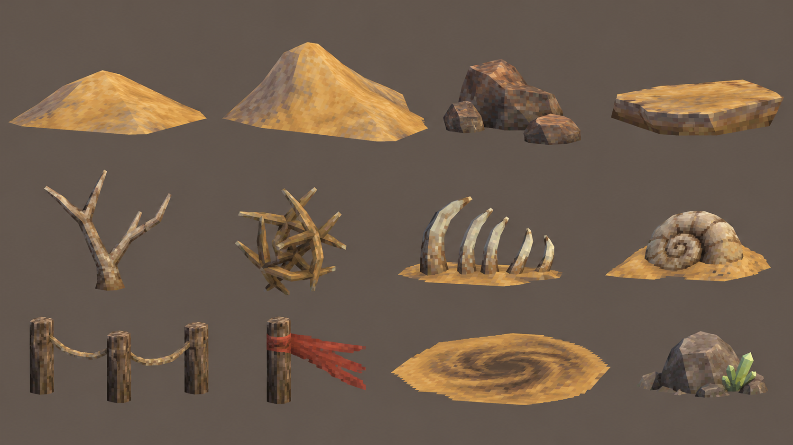
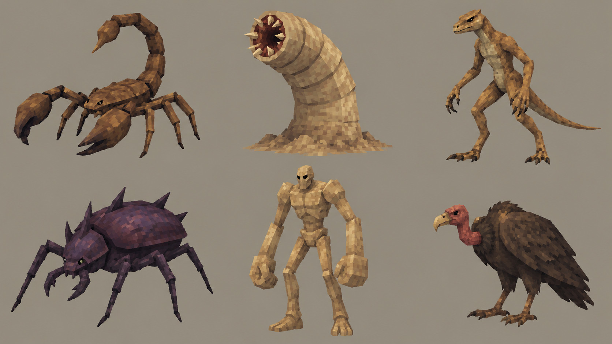
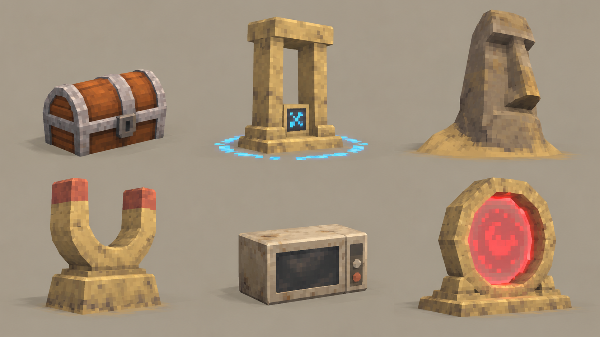

# 02. Бескрайние пески

[Все карты](../../README.md) · [Слайды](slides/README.md) · [← Глубокий лес](01-forest.md) · [Призрачный лес →](03-ghost.md)

**Открытый простор, обманчиво спокойный песок и движение между зыбучими воронками.**

### Атмосфера и графика

После вертикального леса пространство резко раскрывается. Вокруг широкие песчаные волны, похожие друг на друга, и горизонт, почти сливающийся с небом. Чувство бесконечности создаётся крупной формой и цветом. Игрок свободно двигается, но постепенно замечает, что сам грунт может быть опасен.

Большие песчаные склоны покрыты грубой повторяемой текстурой. Палитра ограничена охрой и светлым песком, даль растворяется в тёплой дымке. Камни низкие и геометрически простые. Пирамид и построек нет. Однообразие передаётся крупными повторяющимися формами, а редкие столбы и кости помогают узнавать место.

### Планировка

Открытые участки связаны пологими проходами между песчаными гребнями. Камни редкие и низкие. Большие воронки размещены раздельно; между ними всегда существует широкий обычный грунт. Небольшие ориентиры — выбеленные рёбра, столб с тканью, узнаваемый камень — помогают отличать похожие места. Важные взаимодействия стоят на устойчивой поверхности.

### Ключевая механика: четыре фазы

1. Распознавание: другой оттенок песка и вращающаяся воронка заранее обозначают опасное место.

2. Попадание: при входе движение начинает замедляться, но управление сохраняется.

3. Усиление: пребывание в зоне повышает затруднение движения; ближайший край должен оставаться понятным.

4. Выход: персонаж возвращается на твёрдый грунт, движение восстанавливается; опасный участок продолжает влиять на маршрут.

### Декор: 12 объектов

| № | Объект |
| --- | --- |
| 1 | Низкая дюна |
| 2 | Высокий песчаный гребень |
| 3 | Группа низких камней |
| 4 | Плоская песчаниковая плита |
| 5 | Сухой разветвлённый куст |
| 6 | Перекати-поле |
| 7 | Выбеленные рёбра |
| 8 | Окаменевшая раковина |
| 9 | Низкий верёвочный забор |
| 10 | Столб с красной тканью |
| 11 | Воронка зыбучего песка |
| 12 | Камень с кристаллом |

### Мобы: шесть ролей

| № | Моб | Предлагаемая роль |
| --- | --- | --- |
| 1 | Скорпион | Ближний бой: короткая пауза, затем удар хвостом. |
| 2 | Песчаный червь | Выход из грунта: заранее отмечает место атаки. |
| 3 | Ящер-бегун | Быстрый фланг: вынуждает менять направление. |
| 4 | Колючий жук | Плотная масса: медленно сжимает свободное пространство. |
| 5 | Песчаный громила | Элитный блокировщик: тяжёлый заметный замах. |
| 6 | Стервятник | Воздушный налёт: тень предупреждает о пикировании. |

### Интерактивы: функции, активация, использованное состояние

| № | Объект | Значение | Активация | Предлагаемое использованное состояние |
| --- | --- | --- | --- | --- |
| 1 | Сундук (Chest) | Случайный предмет за золото | Подтвердить покупку | Открытая крышка, сигнал погашен |
| 2 | Charge Shrine (Charge) | Выбор улучшения характеристик | Зарядить, оставаясь в радиусе | Награда получена; индикатор погашен |
| 3 | Moai (Moai) | Выбор бесплатного предмета | Активировать и выбрать | Сигнал доступности исчезает |
| 4 | Shrine of Succ (Succ) | Сбор уже лежащего опыта | Однократно активировать | Воронка темнеет, эффект завершён |
| 5 | Microwave (Microwave) | Дубликат за предмет той же редкости и золото | Выбрать предмет и подтвердить обмен | Счётчик применений; при исчерпании экран гаснет |
| 6 | Boss Portal (Portal) | Босс этапа, затем переход | Вызвать босса, победить | После боя — сигнал открытого выхода |

### Босс — предложение

Песчаный червь-исполин — предложение: заранее поднимает полосу песка и выходит в отмеченном участке. Часть боя проходит вокруг зыбучих зон; безопасные обходы остаются доступными.

### Граница и следующий биом

Низкий верёвочный забор, редкие столбы и красные тканевые маркеры обозначают игровую область. Коллизия совпадает с видимой линией. Вдали песчаный фон продолжается, поэтому граница не превращается в стену поперёк горизонта. Идею парящего неровного края можно проверить отдельным вариантом мира, но она не закреплена для всех карт.

Появляются засохшие сосны и отдельный зеленоватый огонёк между ними. На краю песка тянется полоска серо-зелёного грунта. Это переход к призрачному лесу. Окаменевшая раковина остаётся редкой находкой мира и не задаёт ближайший переход.

### Сквозной сигнал — предложение

Маленький квадратный оранжевый индикатор в плоском камне рядом с одним из пограничных столбов. Предлагаемый новый предмет; не путать с цветом кристалла на доске.

---

[Все карты](../../README.md) · [Слайды](slides/README.md) · [← Глубокий лес](01-forest.md) · [Призрачный лес →](03-ghost.md)
