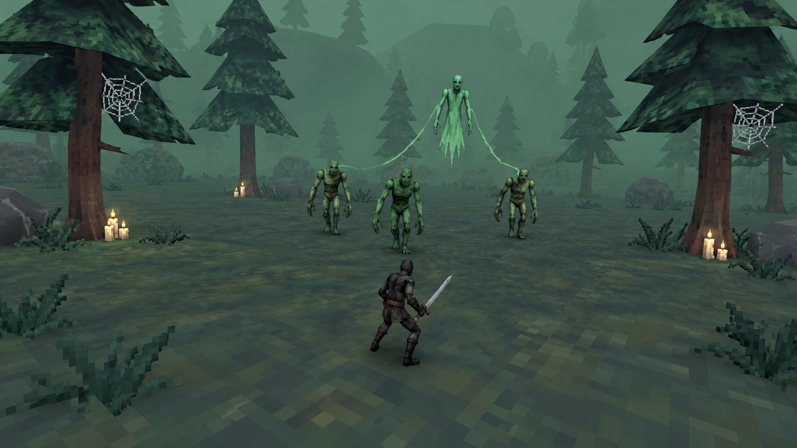
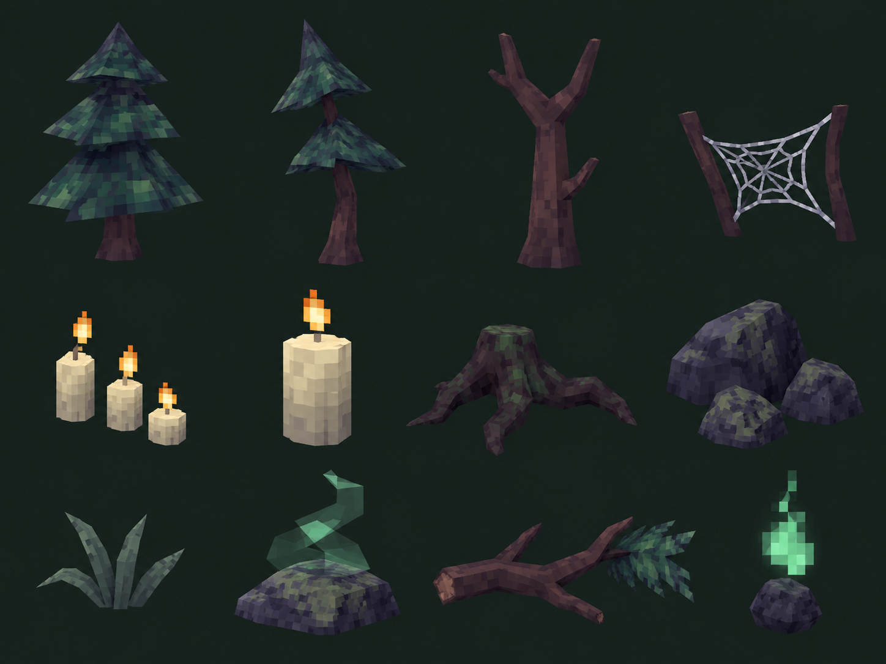
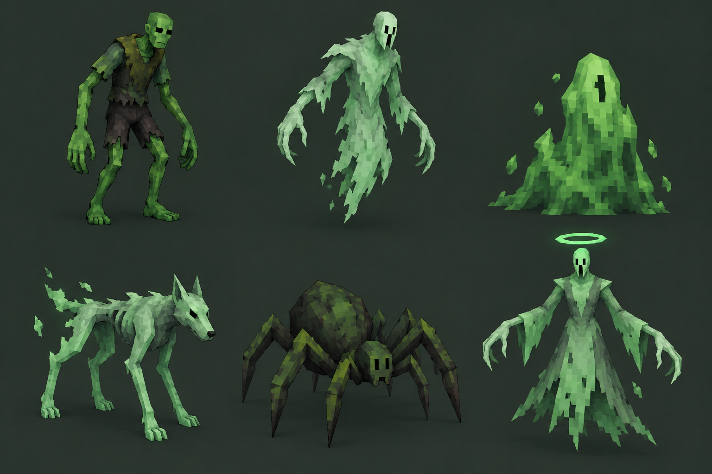
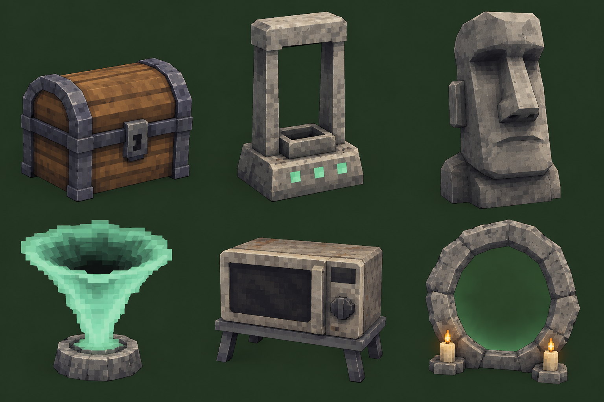

# 03. Призрачный лес

[Все карты](../../README.md) · [Слайды](slides/README.md) · [← Бескрайние пески](02-desert.md) · [Купол на дне →](04-underwater.md)

**Найди того, кто разгоняет толпу**

### Атмосфера и графика

Третий биом меняет спокойный открытый горизонт на тревожный хвойный лес. Паутина, свечи и зелёные существа создают хэллоуинское настроение. Призраки могут быть смешными и неприятными одновременно. Главный источник давления — дух, который сопровождает бой и усиливает других мобов.

Простые ярусы хвои имеют заметный грубый пиксельный рисунок. Белая паутина и свечи дают редкие акценты на тёмно-зелёном фоне. Туман зелёный и преимущественно дистанционный. Зомби вытянутые, призраки рваные и угловатые. Без тыкв, зданий, замков и декоративных кладбищ; без милых маскотов с огромными глазами.

### Планировка

Деревья обрамляют широкие поляны, между которыми проходит несколько путей. Свечи, камни и паутина стоят у стволов и на краях. Между духом и игроком остаётся доступный маршрут, чтобы приоритетную цель действительно можно было преследовать. Крупная поляна позволяет видеть, какие группы получили усиление.

### Ключевая механика: четыре фазы

1. Появление: отдельный звук и силуэт над толпой сообщают, что пришёл дух-усилитель.

2. Связь: видимые зелёные линии соединяют духа с выбранными мобами; в первом прототипе они получают один понятный бонус — скорость.

3. Охота: игрок решает, продолжать обход группы или пробиться к источнику усиления; дух остаётся достижимой и уязвимой целью.

4. Разрыв: после поражения духа связи исчезают, усиление снимается, наступает передышка перед следующим появлением.

### Декор: 12 объектов

| № | Объект |
| --- | --- |
| 1 | Высокая сосна |
| 2 | Кривая редкая сосна |
| 3 | Мёртвый ствол |
| 4 | Паутина между ветвями |
| 5 | Три свечи |
| 6 | Толстая свеча |
| 7 | Тёмный корень |
| 8 | Группа угловатых камней |
| 9 | Тусклая трава |
| 10 | Источник зелёного тумана |
| 11 | Упавшая хвойная ветвь |
| 12 | Призрачный огонёк |

### Мобы: шесть ролей

| № | Моб | Предлагаемая роль |
| --- | --- | --- |
| 1 | Зелёный зомби | Основная пешая масса; особенно опасен под усилением. |
| 2 | Бледный призрак | Плавающий преследователь с простым силуэтом. |
| 3 | Сгусток эктоплазмы | Эктоплазменный противник; занимает свободные промежутки в толпе. |
| 4 | Призрачный пёс | Быстрый фланговый враг с коротким разгоном. |
| 5 | Лесной паук | Короткая атака вперёд после заметной подготовки. |
| 6 | Дух-усилитель | Приоритетная цель: держится над группой и ускоряет связанных мобов. |

### Интерактивы: функции, активация, использованное состояние

| № | Объект | Значение | Активация | Предлагаемое использованное состояние |
| --- | --- | --- | --- | --- |
| 1 | Старый сундук (Chest) | Случайный предмет за золото | Подтвердить покупку | Открытая крышка, сигнал погашен |
| 2 | Бледная каменная рама зарядки (Charge) | Выбор улучшения характеристик | Зарядить, оставаясь в радиусе | Награда получена; индикатор погашен |
| 3 | Бледная каменная голова (Moai) | Выбор бесплатного предмета | Активировать и выбрать | Сигнал доступности исчезает |
| 4 | Воронка эктоплазмы (Succ) | Сбор уже лежащего опыта | Однократно активировать | Воронка темнеет, эффект завершён |
| 5 | Потускневший дубликатор (Microwave) | Дубликат за предмет той же редкости и золото | Выбрать предмет и подтвердить обмен | Счётчик применений; при исчерпании экран гаснет |
| 6 | Светящееся кольцо (Portal) | Босс этапа, затем переход | Вызвать босса, победить | После боя — сигнал открытого выхода |

### Босс — предложение

Большой дух-пастух: усиливает волны, а между призывами остаётся уязвимым.

### Граница и следующий биом

Плотнее стоящие сосны и туман формируют дальний периметр, но коллизия располагается по понятным стволам и видимым естественным препятствиям. Перед непроходимым участком должна быть возможность повернуть. Крупные растения не закрывают камеру рядом с персонажем.

Земля становится влажной, между корнями появляются ракушки и водные отблески. Туман постепенно получает бирюзовый оттенок. Следующий биом — купол на морском дне.

### Сквозной сигнал — предложение

Небольшой камень у свечей с квадратным оранжевым знаком. Он отличается от зелёного света призраков и постепенно повторяет уже встреченный мотив.

---

[Все карты](../../README.md) · [Слайды](slides/README.md) · [← Бескрайние пески](02-desert.md) · [Купол на дне →](04-underwater.md)
