# Шесть биомов: концепт-бук v2

Подробное дополнение к новой презентации. **Наши карты в графическом языке Megabonk: грубый ретро low-poly 3D с заметными пиксельными текстурами. Без реализма.**

Перед разработкой подготовлены три исследования:

- [Графика, камера и окружение оригинала](research/style.md).
- [Взаимодействия, их функции и рескины](research/interactions.md).
- [Враги, боссы и обязательная конструкция лунного босса](research/enemies-boss.md).

Визуальные наблюдения опираются на официальные игровые скриншоты. Функции стандартных объектов изучены отдельно. Новые биомы, их механики и варианты боссов — наши предложения; они не выдаются за существующий контент Megabonk.

## Порядок карт и развитие впечатления

**Глубокий лес → бескрайние пески → призрачный лес → купол на дне → вулкан → Луна.**

| № | Карта | Что меняется | Основное решение игрока |
| --- | --- | --- | --- |
| 1 | Глубокий лес | Вертикальный масштаб и простор под кронами | Когда использовать верёвку и куда приземлиться |
| 2 | Бескрайние пески | Открытый тёплый горизонт | Где безопасный грунт |
| 3 | Призрачный лес | Холодная зелень и давление поддержки | Когда переключаться на духа-усилителя |
| 4 | Купол на дне | Новый масштаб мира за оболочкой | Как завершить цель до разрушения |
| 5 | Вулкан | Горячая чаша с ритмическими угрозами | Как менять маршрут между выбросами |
| 6 | Луна | Холодный простор и длинные прыжки | Как использовать высоту и выбрать приземление |

Такой порядок чередует открытое и укрытое по атмосфере пространство, тёплые и холодные цвета, спокойное исследование и давление. Купол остаётся четвёртой картой. Вулкан заранее знакомит с дизайном роботов, которые затем встречаются на Луне целыми.

## Единый визуальный язык v2

Сохраняем простую трёхмерную геометрию, несколько крупных деталей на модели и грубые низкорезолюционные UV-текстуры. На грунте видны повторяемые блоки цвета; на листве, коре, камне и телах — крупные квадратные пятна. Это текстуры внутри 3D-поверхностей, не плоская пиксельная иллюстрация и не мозаичный фильтр поверх картинки.

Гуманоиды имеют небольшую голову, вытянутые конечности и читаемую позу. Допустима комичность, но общая линейка не превращается в милых маскотов. Свет обычный игровой, даль уходит в простой цветной туман. Высокая детализация материалов, глянцевая броня, кинематографические лучи и дорогой предметный рендер не нужны.

Камера — перспективная, за героем и немного выше него. Видны ближайший грунт, толпа и дальние ориентиры. Пол остаётся достаточно свободным, чтобы бегать вокруг врагов. Сцена не должна походить на густо украшенную диораму.

Все каталоги ниже читаются **слева направо, сверху вниз**. Декор — сетка 4 × 3; мобы и интерактивы — 3 × 2. В каждой карте одинаковый порядок интерактивов: **Chest → Charge → Moai → Succ → Microwave → Portal**.

---

## 1. Глубокий лес

**Учимся держать темп и менять позицию по воздуху**

### Атмосфера и графика

Первый биом даёт понятную опору: земля, деревья, открытая поляна. Масштаб раскрывается вверх — стволы уходят в высокие кроны, которые почти полностью закрывают небо. Атмосфера живая и приключенческая. Самая сильная деталь — верёвка, на которой можно сменить позицию посреди боя.

Грубая пиксельная кора, пятнистая низкорезолюционная листва и повторяемая текстура земли создают ретро 3D. Стволы и комки кроны сделаны немногими плоскостями. Верёвка выделяется светлым цветом. Дальний план уходит в сине-зелёный туман; у ног игрока сохраняется контраст. Убираем гладкие однотонные кроны, сложные корни и декоративные ковры папоротников.

### Планировка

Крупные стволы расставлены отдельными опорами. Между ними — связанные поляны и широкие петли для обхода толпы. Корни пологие; мелкие папоротники и грибы стоят по краям маршрутов. Точки зацепа ведут с занятой поляны на соседнюю открытую площадку. Игрок заранее видит пространство приземления. Центральная поляна подходит для встречи с крупным врагом.

### Ключевая механика: четыре фазы

1. Обнаружение: светлая верёвка с петлёй выделяется на фоне ствола; положение ветви показывает направление движения.

2. Зацеп: игрок активирует взаимодействие в понятной зоне; конкретный ввод определяется прототипом управления.

3. Раскачивание и отпускание: персонаж идёт по читаемой дуге, игрок выбирает подходящий момент выхода.

4. Приземление: открытая площадка даёт возможность продолжить бег; верёвка снова становится доступным ориентиром.

### Декор: 12 объектов

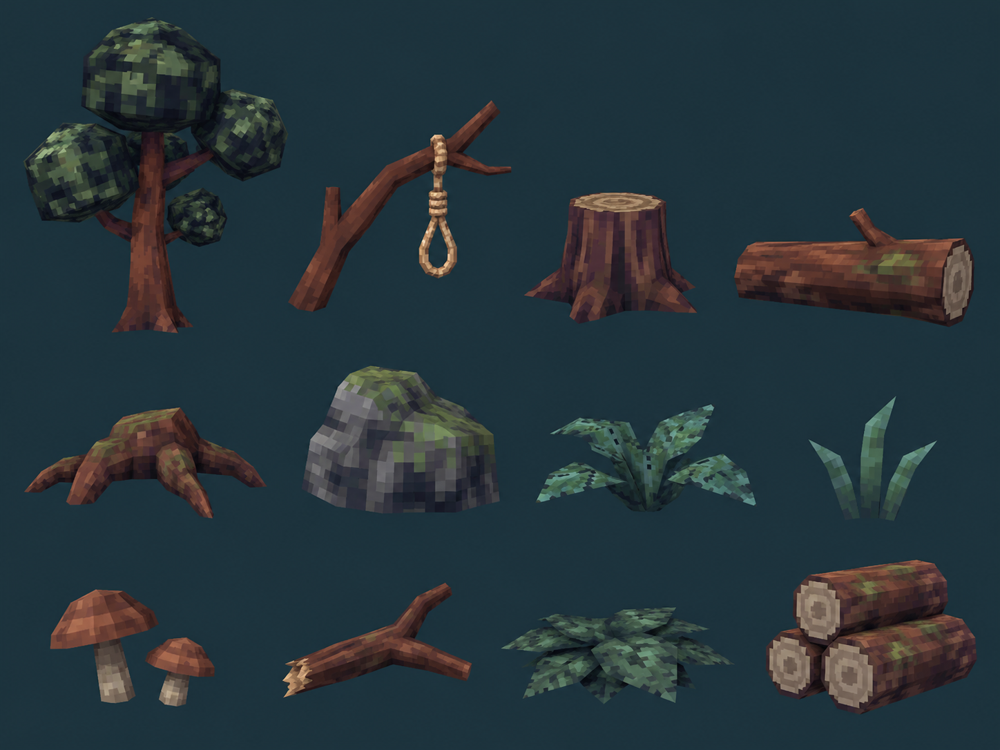

| № | Объект |
| --- | --- |
| 1 | Гигантское дерево |
| 2 | Ветка с верёвкой |
| 3 | Срубленный пень |
| 4 | Поваленное бревно |
| 5 | Пологий корень |
| 6 | Мшистый камень |
| 7 | Низкий папоротник |
| 8 | Пучок травы |
| 9 | Группа грибов |
| 10 | Сломанная ветвь |
| 11 | Куча листвы |
| 12 | Штабель брёвен |

### Мобы: шесть ролей

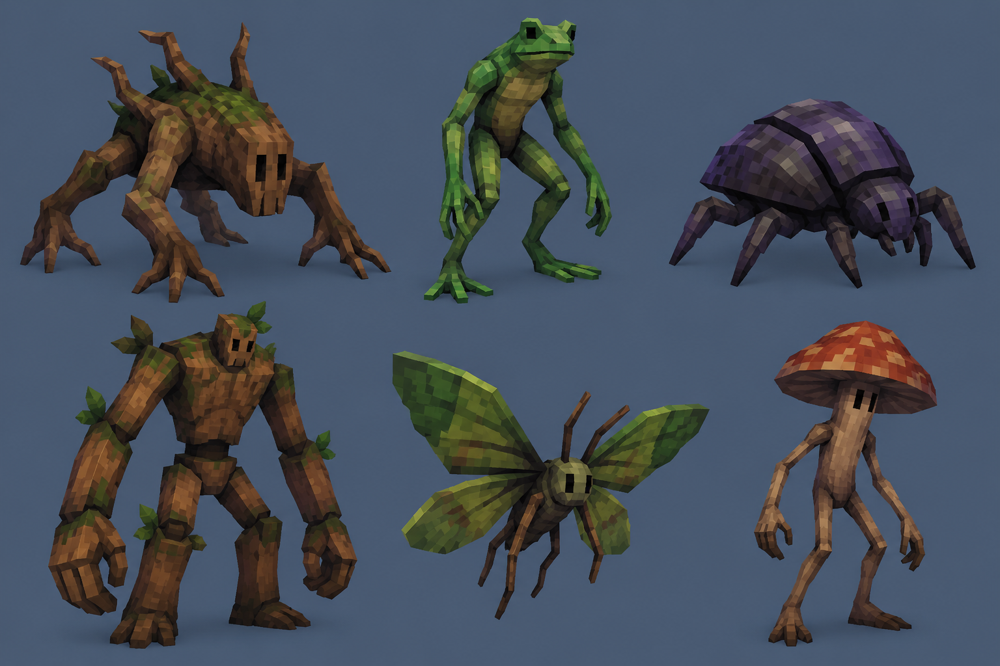

| № | Моб | Предлагаемая роль |
| --- | --- | --- |
| 1 | Корневой ползун | Базовая наземная масса; обходит игрока группой. |
| 2 | Лягушка-прыгун | Заранее приседает и прыгает в отмеченную точку. |
| 3 | Жук-скалолаз | Сходит со ствола и атакует коротким рывком. |
| 4 | Древесный громила | Медленный тяжёлый удар, вынуждающий освободить сектор. |
| 5 | Лесная моль | Летает низко; добавляет угрозу на открытой поляне. |
| 6 | Грибной ходок | Короткая зона спор рядом с собой. |

### Интерактивы: функции, активация, использованное состояние

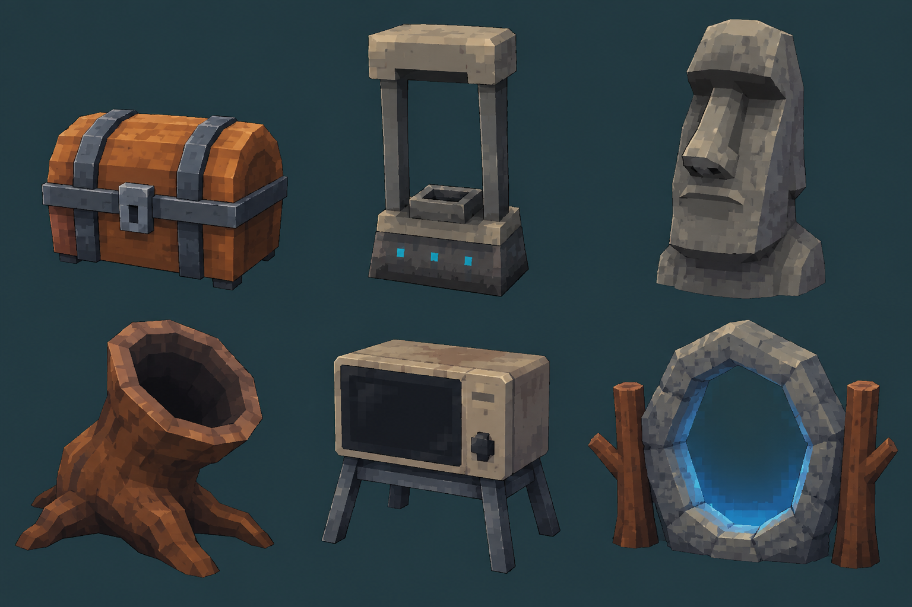

| № | Объект | Значение | Активация | Предлагаемое использованное состояние |
| --- | --- | --- | --- | --- |
| 1 | Деревянный сундук (Chest) | Случайный предмет за золото | Подтвердить покупку | Открытая крышка, сигнал погашен |
| 2 | Простая каменная рама зарядки (Charge) | Выбор улучшения характеристик | Зарядить, оставаясь в радиусе | Награда получена; индикатор погашен |
| 3 | Простая каменная голова (Moai) | Выбор бесплатного предмета | Активировать и выбрать | Сигнал доступности исчезает |
| 4 | Полый корень-воронка (Succ) | Сбор уже лежащего опыта | Однократно активировать | Воронка темнеет, эффект завершён |
| 5 | Походный ящик-дубликатор (Microwave) | Дубликат за предмет той же редкости и золото | Выбрать предмет и подтвердить обмен | Счётчик применений; при исчерпании экран гаснет |
| 6 | Кольцо между стволами (Portal) | Босс этапа, затем переход | Вызвать босса, победить | После боя — сигнал открытого выхода |

### Босс — предложение

Старый корневой исполин: замахи крупными руками и паузы, позволяющие сменить сторону через верёвку.

### Граница и следующий биом

Живой лес переходит в вырубку: пни, поваленные стволы и штабели брёвен дают понятный визуальный порог. При уходе дальше появляется сообщение о возвращении. Способ мягкого возврата подбирается в прототипе. Мелкие пни не должны незаметно ловить персонажа за ноги.

К концу биома деревья редеют. Грунт становится суше, появляются светлый песок и редкие пучки выгоревшей травы. На дальнем плане проступает широкая линия дюны: следующий биом — пустыня.

### Сквозной сигнал — предложение

Небольшая пластина в пне у одной из верёвок с квадратным оранжевым огоньком. Это предлагаемая дополнительная деталь, отсутствующая на основной доске декораций.

---

## 2. Бескрайние пески

**Открытый простор, обманчиво спокойный песок и движение между зыбучими воронками.**

### Атмосфера и графика

После вертикального леса пространство резко раскрывается. Вокруг широкие песчаные волны, похожие друг на друга, и горизонт, почти сливающийся с небом. Чувство бесконечности создаётся крупной формой и цветом. Игрок свободно двигается, но постепенно замечает, что сам грунт может быть опасен.

Большие песчаные склоны покрыты грубой повторяемой текстурой. Палитра ограничена охрой и светлым песком, даль растворяется в тёплой дымке. Камни низкие и геометрически простые. Пирамид и построек нет. Однообразие передаётся крупными повторяющимися формами, а редкие столбы и кости помогают узнавать место.

### Планировка

Открытые участки связаны пологими проходами между песчаными гребнями. Камни редкие и низкие. Большие воронки размещены раздельно; между ними всегда существует широкий обычный грунт. Небольшие ориентиры — выбеленные рёбра, столб с тканью, узнаваемый камень — помогают отличать похожие места. Важные взаимодействия стоят на устойчивой поверхности.

### Ключевая механика: четыре фазы

1. Распознавание: другой оттенок песка и вращающаяся воронка заранее обозначают опасное место.

2. Попадание: при входе движение начинает замедляться, но управление сохраняется.

3. Усиление: пребывание в зоне повышает затруднение движения; ближайший край должен оставаться понятным.

4. Выход: персонаж возвращается на твёрдый грунт, движение восстанавливается; опасный участок продолжает влиять на маршрут.

### Декор: 12 объектов

| № | Объект |
| --- | --- |
| 1 | Низкая дюна |
| 2 | Высокий песчаный гребень |
| 3 | Группа низких камней |
| 4 | Плоская песчаниковая плита |
| 5 | Сухой разветвлённый куст |
| 6 | Перекати-поле |
| 7 | Выбеленные рёбра |
| 8 | Окаменевшая раковина |
| 9 | Низкий верёвочный забор |
| 10 | Столб с красной тканью |
| 11 | Воронка зыбучего песка |
| 12 | Камень с кристаллом |

### Мобы: шесть ролей

| № | Моб | Предлагаемая роль |
| --- | --- | --- |
| 1 | Скорпион | Ближний бой: короткая пауза, затем удар хвостом. |
| 2 | Песчаный червь | Выход из грунта: заранее отмечает место атаки. |
| 3 | Ящер-бегун | Быстрый фланг: вынуждает менять направление. |
| 4 | Колючий жук | Плотная масса: медленно сжимает свободное пространство. |
| 5 | Песчаный громила | Элитный блокировщик: тяжёлый заметный замах. |
| 6 | Стервятник | Воздушный налёт: тень предупреждает о пикировании. |

### Интерактивы: функции, активация, использованное состояние

| № | Объект | Значение | Активация | Предлагаемое использованное состояние |
| --- | --- | --- | --- | --- |
| 1 | Сундук (Chest) | Случайный предмет за золото | Подтвердить покупку | Открытая крышка, сигнал погашен |
| 2 | Charge Shrine (Charge) | Выбор улучшения характеристик | Зарядить, оставаясь в радиусе | Награда получена; индикатор погашен |
| 3 | Moai (Moai) | Выбор бесплатного предмета | Активировать и выбрать | Сигнал доступности исчезает |
| 4 | Shrine of Succ (Succ) | Сбор уже лежащего опыта | Однократно активировать | Воронка темнеет, эффект завершён |
| 5 | Microwave (Microwave) | Дубликат за предмет той же редкости и золото | Выбрать предмет и подтвердить обмен | Счётчик применений; при исчерпании экран гаснет |
| 6 | Boss Portal (Portal) | Босс этапа, затем переход | Вызвать босса, победить | После боя — сигнал открытого выхода |

### Босс — предложение

Песчаный червь-исполин — предложение: заранее поднимает полосу песка и выходит в отмеченном участке. Часть боя проходит вокруг зыбучих зон; безопасные обходы остаются доступными.

### Граница и следующий биом

Низкий верёвочный забор, редкие столбы и красные тканевые маркеры обозначают игровую область. Коллизия совпадает с видимой линией. Вдали песчаный фон продолжается, поэтому граница не превращается в стену поперёк горизонта. Идею парящего неровного края можно проверить отдельным вариантом мира, но она не закреплена для всех карт.

Появляются засохшие сосны и отдельный зеленоватый огонёк между ними. На краю песка тянется полоска серо-зелёного грунта. Это переход к призрачному лесу. Окаменевшая раковина остаётся редкой находкой мира и не задаёт ближайший переход.

### Сквозной сигнал — предложение

Маленький квадратный оранжевый индикатор в плоском камне рядом с одним из пограничных столбов. Предлагаемый новый предмет; не путать с цветом кристалла на доске.

---

## 3. Призрачный лес

**Найди того, кто разгоняет толпу**

### Атмосфера и графика

Третий биом меняет спокойный открытый горизонт на тревожный хвойный лес. Паутина, свечи и зелёные существа создают хэллоуинское настроение. Призраки могут быть смешными и неприятными одновременно. Главный источник давления — дух, который сопровождает бой и усиливает других мобов.

Простые ярусы хвои имеют заметный грубый пиксельный рисунок. Белая паутина и свечи дают редкие акценты на тёмно-зелёном фоне. Туман зелёный и преимущественно дистанционный. Зомби вытянутые, призраки рваные и угловатые. Без тыкв, зданий, замков и декоративных кладбищ; без милых маскотов с огромными глазами.

### Планировка

Деревья обрамляют широкие поляны, между которыми проходит несколько путей. Свечи, камни и паутина стоят у стволов и на краях. Между духом и игроком остаётся доступный маршрут, чтобы приоритетную цель действительно можно было преследовать. Крупная поляна позволяет видеть, какие группы получили усиление.

### Ключевая механика: четыре фазы

1. Появление: отдельный звук и силуэт над толпой сообщают, что пришёл дух-усилитель.

2. Связь: видимые зелёные линии соединяют духа с выбранными мобами; в первом прототипе они получают один понятный бонус — скорость.

3. Охота: игрок решает, продолжать обход группы или пробиться к источнику усиления; дух остаётся достижимой и уязвимой целью.

4. Разрыв: после поражения духа связи исчезают, усиление снимается, наступает передышка перед следующим появлением.

### Декор: 12 объектов

| № | Объект |
| --- | --- |
| 1 | Высокая сосна |
| 2 | Кривая редкая сосна |
| 3 | Мёртвый ствол |
| 4 | Паутина между ветвями |
| 5 | Три свечи |
| 6 | Толстая свеча |
| 7 | Тёмный корень |
| 8 | Группа угловатых камней |
| 9 | Тусклая трава |
| 10 | Источник зелёного тумана |
| 11 | Упавшая хвойная ветвь |
| 12 | Призрачный огонёк |

### Мобы: шесть ролей

| № | Моб | Предлагаемая роль |
| --- | --- | --- |
| 1 | Зелёный зомби | Основная пешая масса; особенно опасен под усилением. |
| 2 | Бледный призрак | Плавающий преследователь с простым силуэтом. |
| 3 | Сгусток эктоплазмы | Эктоплазменный противник; занимает свободные промежутки в толпе. |
| 4 | Призрачный пёс | Быстрый фланговый враг с коротким разгоном. |
| 5 | Лесной паук | Короткая атака вперёд после заметной подготовки. |
| 6 | Дух-усилитель | Приоритетная цель: держится над группой и ускоряет связанных мобов. |

### Интерактивы: функции, активация, использованное состояние

| № | Объект | Значение | Активация | Предлагаемое использованное состояние |
| --- | --- | --- | --- | --- |
| 1 | Старый сундук (Chest) | Случайный предмет за золото | Подтвердить покупку | Открытая крышка, сигнал погашен |
| 2 | Бледная каменная рама зарядки (Charge) | Выбор улучшения характеристик | Зарядить, оставаясь в радиусе | Награда получена; индикатор погашен |
| 3 | Бледная каменная голова (Moai) | Выбор бесплатного предмета | Активировать и выбрать | Сигнал доступности исчезает |
| 4 | Воронка эктоплазмы (Succ) | Сбор уже лежащего опыта | Однократно активировать | Воронка темнеет, эффект завершён |
| 5 | Потускневший дубликатор (Microwave) | Дубликат за предмет той же редкости и золото | Выбрать предмет и подтвердить обмен | Счётчик применений; при исчерпании экран гаснет |
| 6 | Светящееся кольцо (Portal) | Босс этапа, затем переход | Вызвать босса, победить | После боя — сигнал открытого выхода |

### Босс — предложение

Большой дух-пастух: усиливает волны, а между призывами остаётся уязвимым.

### Граница и следующий биом

Плотнее стоящие сосны и туман формируют дальний периметр, но коллизия располагается по понятным стволам и видимым естественным препятствиям. Перед непроходимым участком должна быть возможность повернуть. Крупные растения не закрывают камеру рядом с персонажем.

Земля становится влажной, между корнями появляются ракушки и водные отблески. Туман постепенно получает бирюзовый оттенок. Следующий биом — купол на морском дне.

### Сквозной сигнал — предложение

Небольшой камень у свечей с квадратным оранжевым знаком. Он отличается от зелёного света призраков и постепенно повторяет уже встреченный мотив.

---

## 4. Купол на дне

**Яркое морское дно, пираты-рыболюди и защита, у которой заканчивается время.**

### Атмосфера и графика

Четвёртая карта даёт яркую смену после мрачного леса. Игрок бегает по морскому дну внутри воздушного купола, а снаружи существует огромный подводный мир. Красивое и смешное окружение постепенно становится тревожным, когда защитная оболочка трескается.

Бирюзовая вода и кораллы остаются цветными, но поверхность грунта, раковин и существ передаётся грубой пиксельной фактурой. Формы редкие, простые, местами угловатые; нет глянцевой игрушечности. Внутри воздушного купола обычный игровой свет. Вода за оболочкой условная, без физически точного преломления и дорогого стеклянного шейдера.

### Планировка

В центре — просторная песчаная арена с широким кольцевым обходом. Кораллы и морские камни сгруппированы у краёв, оставляя привычное движение по сухому дну. Прозрачная оболочка даёт понятную круглую границу. Акулы, стаи рыб и скат плавают за ней. Маленький декоративный краб, морские звёзды и ракушки разнообразят дно.

### Ключевая механика: четыре фазы

1. Целый купол: оболочка спокойна, маршрут и цель понятны; таймер показывает запас защиты.

2. Первые трещины: простой рисунок повреждений и отдельные звуки сообщают, что время уходит.

3. Сильные повреждения: трещины заметнее, появляются небольшие протечки и тревожные сигналы, но обзор боя сохраняется.

4. Критическое состояние: игрок должен закончить рабочую цель — победить босса и открыть выход — до разрушения. Последствие провала и точное время проверяются в прототипе.

### Декор: 12 объектов

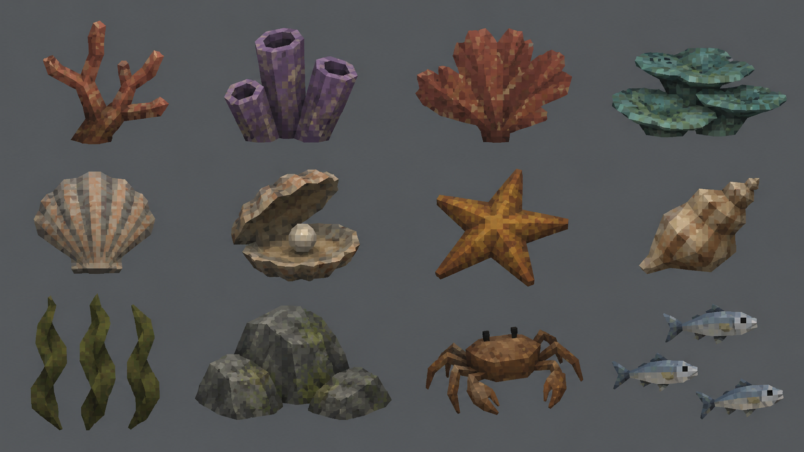

| № | Объект |
| --- | --- |
| 1 | Бурый ветвистый коралл |
| 2 | Трубчатый коралл |
| 3 | Ржавый веерный коралл |
| 4 | Тусклые коралловые пластины |
| 5 | Раковина-гребешок |
| 6 | Ракушка с жемчужиной |
| 7 | Морская звезда |
| 8 | Спиральная раковина |
| 9 | Тёмные водоросли |
| 10 | Морские камни |
| 11 | Маленький краб |
| 12 | Серебристые рыбы |

### Мобы: шесть ролей

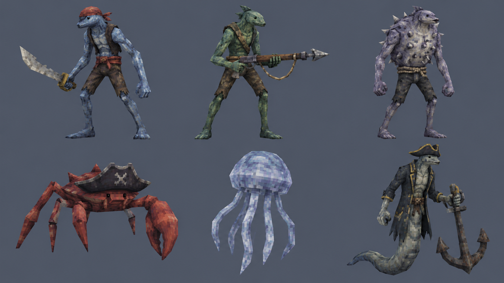

| № | Моб | Предлагаемая роль |
| --- | --- | --- |
| 1 | Рыба-пират | Основная толпа: преследование и короткий удар саблей. |
| 2 | Гарпунщик | Дальний бой: заметная прямая линия перед выстрелом. |
| 3 | Иглобрюх-матрос | Контроль области: раздувается перед круговой атакой. |
| 4 | Краб-корсар | Броня и ближний бой: большая клешня задаёт сторону угрозы. |
| 5 | Медуза | Медленная опасная зона: требует обхода, не перекрывает всю арену. |
| 6 | Капитан-угорь | Элита: широкий удар якорем с длинным предупреждением. |

### Интерактивы: функции, активация, использованное состояние

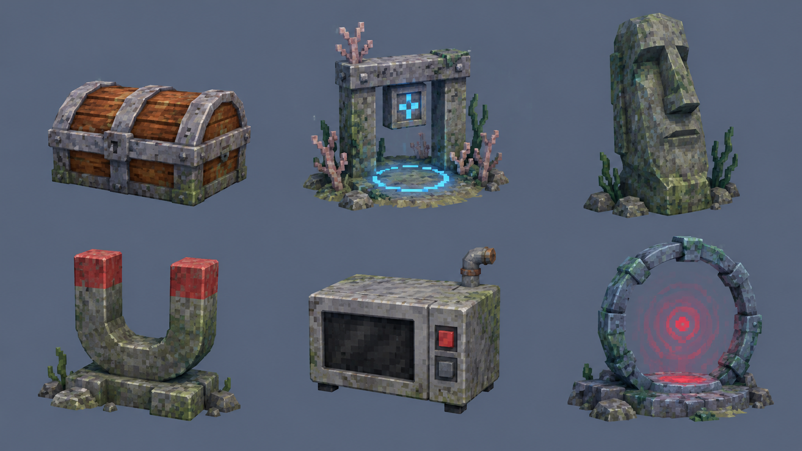

| № | Объект | Значение | Активация | Предлагаемое использованное состояние |
| --- | --- | --- | --- | --- |
| 1 | Сундук (Chest) | Случайный предмет за золото | Подтвердить покупку | Открытая крышка, сигнал погашен |
| 2 | Charge Shrine (Charge) | Выбор улучшения характеристик | Зарядить, оставаясь в радиусе | Награда получена; индикатор погашен |
| 3 | Moai (Moai) | Выбор бесплатного предмета | Активировать и выбрать | Сигнал доступности исчезает |
| 4 | Shrine of Succ (Succ) | Сбор уже лежащего опыта | Однократно активировать | Воронка темнеет, эффект завершён |
| 5 | Microwave (Microwave) | Дубликат за предмет той же редкости и золото | Выбрать предмет и подтвердить обмен | Счётчик применений; при исчерпании экран гаснет |
| 6 | Boss Portal (Portal) | Босс этапа, затем переход | Вызвать босса, победить | После боя — сигнал открытого выхода |

### Босс — предложение

Адмирал-рыболюд — предложение: крупный смешной морской капитан с читаемыми гарпунными и якорными атаками. Его победа открывает выход из купола; финальный набор атак требует прототипа.

### Граница и следующий биом

Сам купол является визуальной и игровой границей. Его нижняя кромка совпадает с ограничением движения и читается на песке. Опасные трещины не должны выглядеть как открытый проход. Если предусмотрен выход, он выделяется в оболочке заранее.

Ближе к выходу появляются простые пузырящиеся горячие трещины и тёмные базальтовые камни. Они подготавливают переход к вулкану. Большая тень за куполом остаётся атмосферным намёком, её личность пока не определяется.

### Сквозной сигнал — предложение

Квадратный оранжевый индикатор в небольшом устройстве у нижнего края оболочки. Он визуально перекликается с найденными предметами предыдущих карт.

---

## 5. Вулкан

**На дне жерла: широкая арена, лава и гейзеры**

### Атмосфера и графика

Игрок оказывается глубоко на дне вулканической чаши. Высоко над ним виден круг жерла, а вокруг лежат большие массы чёрной породы и яркая лава. После прозрачного синего купола карта ощущается тяжёлой, горячей и плотной. Опасность исходит от поверхности и её ритма.

Тёмный базальт и застывшая лава покрыты крупными пиксельными пятнами. Оранжевые трещины и выбросы используют простой яркий цвет, а не реалистичную жидкость. Наверху читается круг жерла. Фоновая дымка помогает масштабу, но непрозрачный дым не накрывает бой. Роботы грубые и малодетальные, с узнаваемым квадратным сигналом.

### Планировка

Несколько широких каменных площадок соединены просторными проходами. Лава занимает края и отдельные читаемые участки; карта сохраняет большие места для боя. Гейзеры меняют наиболее удобный путь, но не закрывают все направления одновременно. Обломки роботов встречаются постепенно, от головы и руки до почти целого корпуса.

### Ключевая механика: четыре фазы

1. Предупреждение: трещины у жерла светлеют, звук и простые частицы обозначают ближайший выброс.

2. Подготовка: опасный участок становится отчётливо виден; игрок может уйти по широкому обходу.

3. Выброс: гейзер атакует обозначенную область, лава остаётся ясно отделена от безопасного камня.

4. Затухание: выброс заканчивается, свечение ослабевает, участок возвращается в обычный цикл.

### Декор: 12 объектов

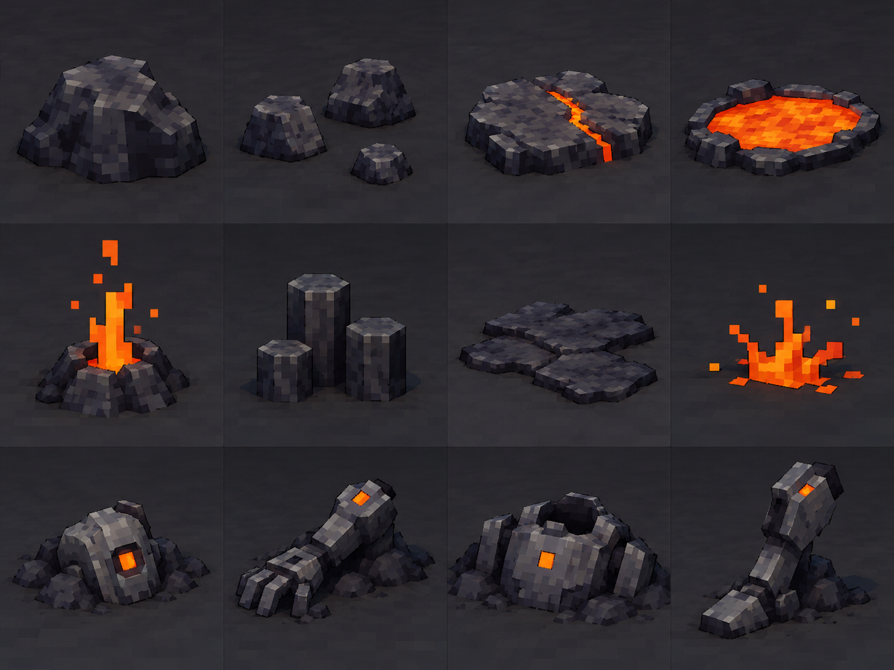

| № | Объект |
| --- | --- |
| 1 | Низкий базальтовый валун |
| 2 | Группа из трёх камней |
| 3 | Плита с горячей трещиной |
| 4 | Небольшая лавовая лужа |
| 5 | Жерло гейзера |
| 6 | Короткие базальтовые колонны |
| 7 | Застывший лавовый пласт |
| 8 | Геометрический всплеск лавы |
| 9 | Расплавленная голова робота |
| 10 | Рука робота в породе |
| 11 | Корпус робота в лаве |
| 12 | Торчащая нога робота |

### Мобы: шесть ролей

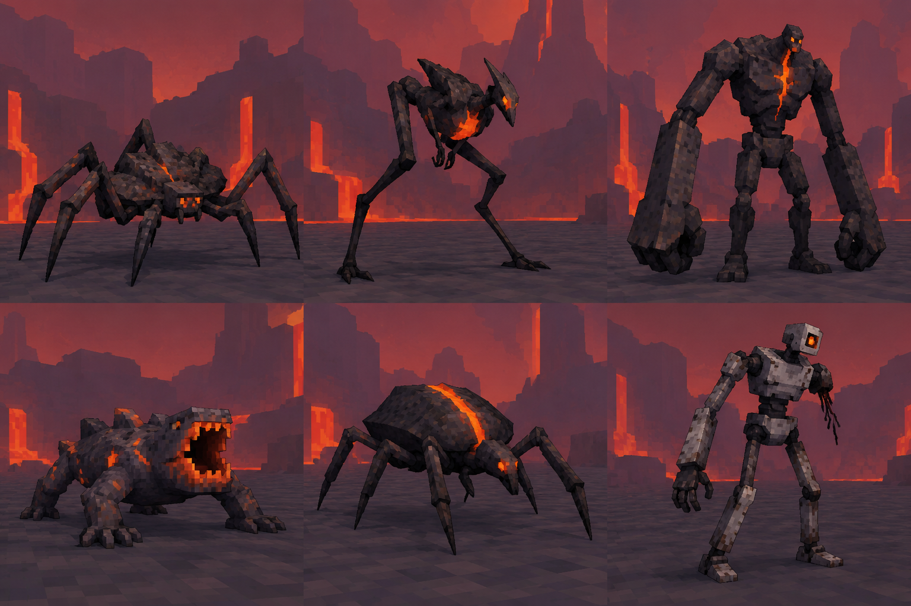

| № | Моб | Предлагаемая роль |
| --- | --- | --- |
| 1 | Угольный краб | Массовый низкий преследователь; держит давление рядом с игроком. |
| 2 | Лавовый прыгун | Тонкий длинноногий лавовый прыгун с маленькой головой. |
| 3 | Базальтовый громила | Медленный танк с хорошо заметным замахом. |
| 4 | Жерлоплюй | Дальний противник; выпускает редкие лавовые сгустки. |
| 5 | Обсидиановый жук | Разгоняется по прямой после короткой подготовки. |
| 6 | Оплавленный робот | Редкий сломанный разведчик; предвещает следующую карту. |

### Интерактивы: функции, активация, использованное состояние

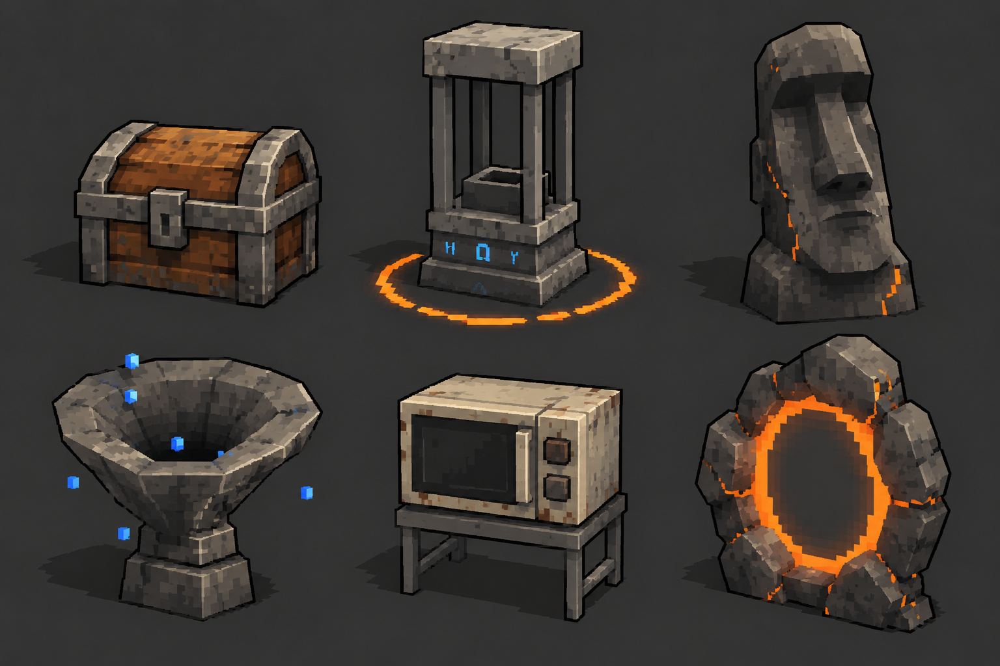

| № | Объект | Значение | Активация | Предлагаемое использованное состояние |
| --- | --- | --- | --- | --- |
| 1 | Сундук с металлическими обручами (Chest) | Случайный предмет за золото | Подтвердить покупку | Открытая крышка, сигнал погашен |
| 2 | Базальтовая клетка зарядки (Charge) | Выбор улучшения характеристик | Зарядить, оставаясь в радиусе | Награда получена; индикатор погашен |
| 3 | Базальтовая голова Моаи (Moai) | Выбор бесплатного предмета | Активировать и выбрать | Сигнал доступности исчезает |
| 4 | Каменная воронка опыта (Succ) | Сбор уже лежащего опыта | Однократно активировать | Воронка темнеет, эффект завершён |
| 5 | Жаростойкая микроволновка (Microwave) | Дубликат за предмет той же редкости и золото | Выбрать предмет и подтвердить обмен | Счётчик применений; при исчерпании экран гаснет |
| 6 | Базальтовое кольцо портала (Portal) | Босс этапа, затем переход | Вызвать босса, победить | После боя — сигнал открытого выхода |

### Босс — предложение

Кузнец жерла: крупный каменный громила, который по очереди запускает видимые группы гейзеров.

### Граница и следующий биом

Основной периметр — стенки чаши и заметные потоки лавы. Верхний круг жерла работает как фон и ориентир, а ближние стенки не нависают над камерой. Узкие мостики не становятся обязательным основным маршрутом.

Расплавленные роботы имеют те же кубические головы и квадратные глаза, что целые враги Луны. Сначала игрок видит фрагмент, затем узнаваемый корпус. На следующей карте тот же дизайн появляется в рабочем состоянии.

### Сквозной сигнал — предложение

Оранжевый квадратный глаз в расплавленной голове робота объединяет отдельные сигналы прошлых биомов с новой технологической темой.

---

## 6. Луна

**Низкая гравитация и кольцевые маршруты кратеров**

### Атмосфера и графика

Завершение предложенной последовательности резко меняет масштаб движения. После тяжёлого вулкана — светлая открытая поверхность и тёмное небо. Кратеры подталкивают двигаться по дугам, а низкая гравитация делает прыжок длинным и заметным. Это шестой биом концепта; окончательное устройство финала ещё обсуждается.

Светло-серый грунт и низкие скалы имеют низкорезолюционную пиксельную текстуру. Шаттлы и роботы собраны из простых крупных частей с минимумом панелей. У гуманоидных роботов небольшая голова и вытянутые конечности. Тёмное небо создаёт контраст, флаги служат цветными ориентирами. Без полированной космической брони, реалистичной пыли и сложной техники.

### Планировка

Большой кратер служит главной ареной. Вокруг — несколько связанных кольцевых путей с пологими съездами и широкими срезами. Игрок может бегать по кругу или пересечь чашу. Небольшие скалы расположены группами и легко обходятся. Шрайны стоят на внешних площадках и узнаются издалека.

### Ключевая механика: четыре фазы

1. Отталкивание: герой прыгает выше привычного, сохраняя отзывчивое горизонтальное управление.

2. Полёт: длинная дуга открывает новый маршрут и даёт время изменить направление.

3. Выбор приземления: наземные луноходы и воздушные дроны заставляют оценивать угрозы на разных высотах; земля остаётся видимой.

4. Приземление: игрок возвращается в быстрый наземный бой и может снова использовать кратерный рельеф.

### Декор: 12 объектов

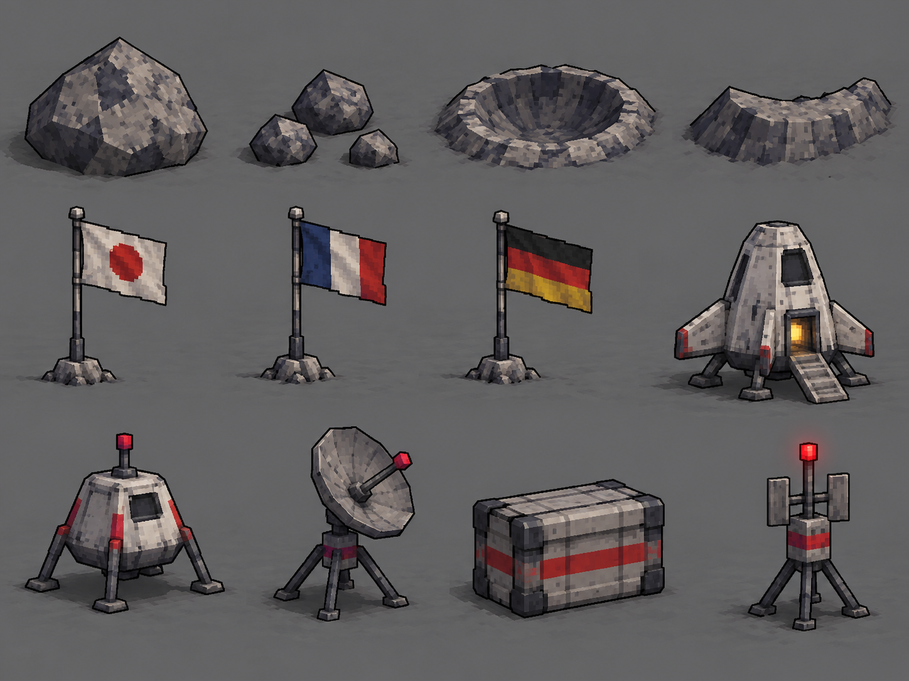

| № | Объект |
| --- | --- |
| 1 | Низкий лунный камень |
| 2 | Группа маленьких скал |
| 3 | Неглубокий кратер |
| 4 | Дуга пологого кратерного гребня |
| 5 | Флаг Японии |
| 6 | Флаг Франции |
| 7 | Флаг Германии |
| 8 | Шаттл-шрайн |
| 9 | Посадочный модуль-шрайн |
| 10 | Низкая антенна |
| 11 | Ящик припасов |
| 12 | Сигнальный маяк на треноге |

### Мобы: шесть ролей

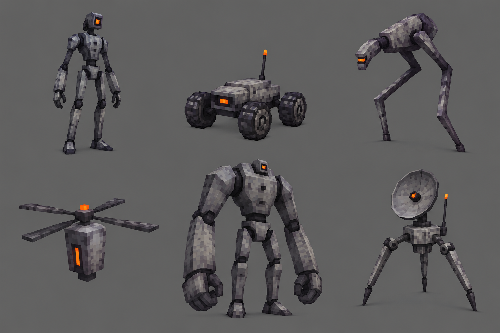

| № | Моб | Предлагаемая роль |
| --- | --- | --- |
| 1 | Робот-ходок | Базовый преследователь; узнаётся по обломкам из вулкана. |
| 2 | Луноход | Колёсный враг с прямолинейным разгоном. |
| 3 | Лунный прыгун | Тонкий длинноногий противник с маленькой головой, прыгает за игроком. |
| 4 | Куб-дрон | Воздушная угроза, заставляющая следить за высотой. |
| 5 | Робот-громила | Медленный элитный враг, наказывает приземление мощным ударом. |
| 6 | Зонд-тренога | Поддержка: отмечает область перед атакой остальных роботов. |

### Интерактивы: функции, активация, использованное состояние

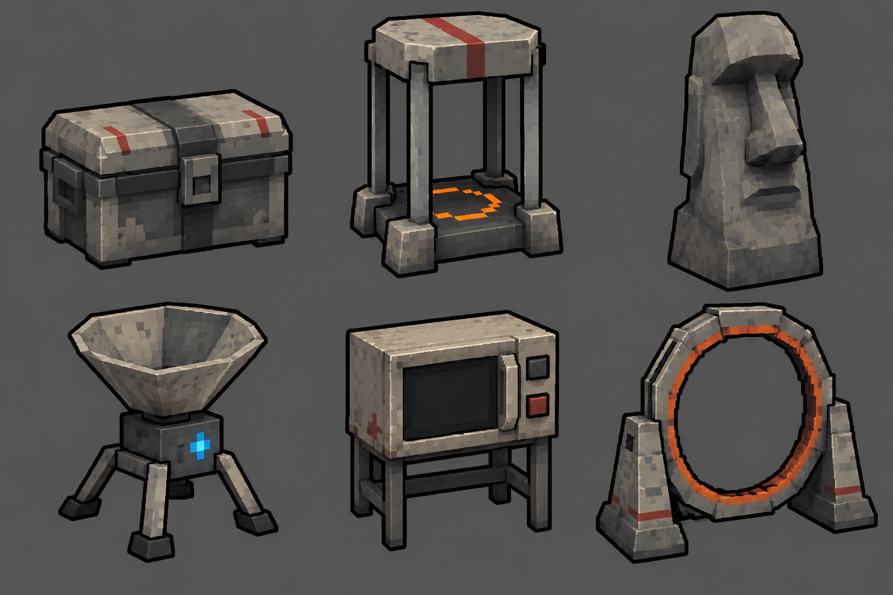

| № | Объект | Значение | Активация | Предлагаемое использованное состояние |
| --- | --- | --- | --- | --- |
| 1 | Контейнер-сундук (Chest) | Случайный предмет за золото | Подтвердить покупку | Открытая крышка, сигнал погашен |
| 2 | Посадочная клетка зарядки (Charge) | Выбор улучшения характеристик | Зарядить, оставаясь в радиусе | Награда получена; индикатор погашен |
| 3 | Голова Моаи из реголита (Moai) | Выбор бесплатного предмета | Активировать и выбрать | Сигнал доступности исчезает |
| 4 | Зонд-сборщик опыта (Succ) | Сбор уже лежащего опыта | Однократно активировать | Воронка темнеет, эффект завершён |
| 5 | Прибор-дубликатор (Microwave) | Дубликат за предмет той же редкости и золото | Выбрать предмет и подтвердить обмен | Счётчик применений; при исчерпании экран гаснет |
| 6 | Посадочное кольцо портала (Portal) | Босс этапа, затем переход | Вызвать босса, победить | После боя — сигнал открытого выхода |

### Босс — предложение

Смотритель кратера — наш авторский вариант босса: крупный вытянутый робот, небольшая голова и две отдельные коробчатые ракетницы сверху на левом и правом плече. Это обязательная конструкция, а не ручное оружие и не скрытый блок за спиной. Несколько больших отверстий достаточно для читаемого силуэта. Грубая серая пиксельная текстура, тёмные шарниры и один оранжевый квадрат связывают его с вулканическими обломками. Предлагаемый бой сочетает ракетные залпы, движение и выбор безопасного места приземления.

### Граница и следующий биом

Пологий край плато, отдельные скалы и заметные маркеры обозначают доступную область. Нельзя прятать стену в визуально свободном кратере. Вариант неровного обрыва с видимым нижним биомом можно использовать только после выбора общей архитектуры мира.

Целые роботы подтверждают связь с обломками вулкана. Повторяющийся квадратный оранжевый сигнал ведёт к предполагаемому источнику. Следующий биом не придумывается: финальная карта и окончательный босс пока не утверждены.

### Сквозной сигнал — предложение

Тот же оранжевый квадрат появляется на плоском маяке или маленьком блоке оборудования; в роботах мотив становится особенно узнаваемым.

---

## Боссы и кульминация последовательности

Линейка боссов — **предложения для наших карт**. Они используют механику своего биома, но не требуют сложной новой системы управления. Общий принцип: крупный силуэт, читаемая подготовка атаки, опасное действие и окно для ответа. На доске — направления образов; точная последовательность атак требует прототипа.

### Лунный босс с двумя плечевыми ракетницами

У босса **две ракетницы на плечах**, отдельная на каждом плече. Это основной признак силуэта. Руки остаются свободными и различимыми, голова небольшая. Корпус собран из простых крупных частей; детализация передаётся грубой низкорезолюционной текстурой. Без множества пластин, проводов, украшений и глянца.

Предлагаемый цикл атаки:

1. Плечевые блоки поворачиваются и дают короткий читаемый сигнал подготовки.
2. Простые ракеты выходят из блоков; след короткий и ступенчатый.
3. Отмеченные зоны падения заставляют учитывать длинный лунный прыжок.
4. После залпа есть окно, в котором удобно атаковать и сменить сторону кратера.

Сигнал подготовки, полёт и отметка на земле должны читаться вместе. Точные длительности, урон и количество ракет не фиксируем. Это авторский концепт; такой босс не приписывается оригинальной игре.

## Общий пул взаимодействий сверх шести основных

Это каталог возможного наполнения. Все типы не обязаны появляться на каждой карте одновременно. Базовую функцию узнают по общему силуэту и интерфейсу; биом меняет материал и цвет. Детальные первоисточники и разночтения перечислены в [исследовании взаимодействий](research/interactions.md).

| Тип | Что даёт игровому циклу | Как показать в наших биомах |
| --- | --- | --- |
| Pots | Разбиваемые сосуды с ресурсами | Глиняный горшок, морская амфора, обожжённый сосуд, простая лунная капсула |
| Challenge Shrine | Активируемая группа сильных врагов с наградой за победу | Узнаваемые скрещённые клинки у небольшого простого корпуса |
| Greed Shrine | Золото в обмен на повышение сложности | Низкий идол с черепом/рогами и явным предупреждением в интерфейсе |
| Boss Curse | Дополнительные копии боссов и связанные награды в рамках исходных правил | Тёмный идол, горячий маяк или другой простой тревожный корпус |
| Shady Guy | Выбор покупки одного предмета; после покупки продавец уходит | Путник, призрачный торговец, рыба-торговец, торговец в шлеме |
| Free / Gold Chest | Бесплатная награда | Узнаваемый сундук с отдельным цветовым акцентом |
| Golden Charge | Зарядка с предложениями высокой редкости | Тот же простой Charge-силуэт с золотым акцентом |
| Golden Moai | Вариант выбора награды высокой редкости | Та же голова с одним золотым акцентом |
| Boomboxes | Исследовательское открытие, связанное с музыкой | Небольшой узнаваемый проигрыватель; размещение адресное |
| Ключ и клетка | Специальное исследовательское открытие | Отдельная постановочная находка, не обязательная клетка в каждом биоме |
| Suspicious Bush / особые встречи | Секретный противник или событие | Объект, уместный для конкретной карты; сначала определить условия |
| Tumbleweed | Разбиваемый катящийся ресурс и отдельные открытия | Простой пыльный клубок в пустыне |

Рескин не даёт права менять функцию молча. Charge улучшает характеристики и не становится обязательным захватом всех точек ради портала. Moai даёт выбор, не слот-машину. Succ собирает существовавший на карте опыт разовым действием, не превращается в постоянный магнит. Microwave требует золото и случайный другой предмет той же редкости; доступные применения показываются в интерфейсе.

**Campfire отдельно:** в изученной системе это предмет, создающий лечащий костёр при остановке. Декоративная свеча, костёр или лампа на карте сама по себе не объявляется бесплатной постоянной точкой лечения.

Использованное состояние в таблицах биомов — наше предложение визуальной обратной связи, не утверждение о точной анимации оригинала. Для Charge базовые правила выхода из радиуса и связей с предметами сохраняются. Для Microwave не фиксируем универсальное число использований. Точную цену и исключения для проклятий боссов сверяем с реализацией исходного цикла.

## Переходы между биомами

| Связка | Короткая визуальная подготовка |
| --- | --- |
| Лес → пустыня | Деревья редеют, трава сохнет, на земле появляется песок |
| Пустыня → призрачный лес | Засохшие сосны, серо-зелёный грунт и один зелёный огонёк |
| Призрачный лес → купол | Влажная земля, ракушки и водные отблески |
| Купол → вулкан | Пузырящиеся горячие трещины, тёмный базальт |
| Вулкан → Луна | Оплавленные части узнаваемых роботов |
| Луна → финал | Повторяющийся сигнал приводит к предполагаемому источнику; финал обсуждается |

Промежуточные смешанные карты пока не обязательны. В конце биома достаточно небольшой группы признаков следующего. Если позже нужен отдельный переходный бой, его можно собрать из уже созданных элементов, но всё равно потребуются планировка и проверка волн.

Окаменевшая раковина в пустынном декоре остаётся редкой находкой, а не указанием на ближайшую подводную карту. Огромная тень за куполом создаёт масштаб; её личность не закреплена.

## Общая отсылка и устройство мира

Предлагаем один сквозной мотив: **квадратный оранжевый сигнал в маленьком предмете каждой карты**. Сначала он выглядит случайной находкой. В вулкане возникает узнаваемый глаз повреждённого робота. На Луне этот же мотив встречается на целых роботах и приборах. Часть таких маленьких предметов ещё потребует отдельного дизайна; не выдаём их за уже показанные позиции на всех досках.

Финальная локация, происхождение сигнала и окончательная роль финального босса остаются открытыми. Смотритель кратера — предложенный босс шестого биома. Его две плечевые ракетницы закреплены как требование визуального дизайна.

Идея неровной карты в воздухе с видимым снизу следующим биомом сохраняется как вариант общей архитектуры. Не переносим обрыв автоматически на купол, вулкан и Луну. Сначала нужно выбрать объяснение пространства и проверить камеру у края. У каждой карты уже описана самостоятельная понятная граница.

## Приоритеты реализации

1. Проверить масштаб персонажа, простоту форм, низкорезолюционные текстуры и игровую камеру в движении.
2. Собрать свободную арену и коллизии крупных объектов, затем добавить редкий мелкий декор.
3. Восстановить общий цикл Chest, Charge, Moai, Succ, Microwave и Portal.
4. Прототипировать одну авторскую особенность биома и её четыре фазы.
5. Добавить мобов по разным ролям и проверить, остаются ли безопасные маршруты.
6. Проверить босса, переход и короткую визуальную отсылку.
7. Настроить урон, время, цены и частоты по игре. Концепт не фиксирует точные балансные числа.

## Состав комплекта

В книге встроены **26 новых изображений v2**: четыре на каждый из шести биомов, общий лист предложений боссов и отдельный лунный босс. Это концепты и референсы для реализации, не готовые 3D-модели и не скриншоты существующих пользовательских карт.

Каталоги включают **72 позиции декора, 36 мобов и 36 рескинов основных интерактивов**. Набор шести функций повторяется для удобства узнавания. Исходные названия находятся в трёх файлах `content-*.json`, точные задания генерации — в `prompts`. Этот концепт-бук задаёт сводный порядок переходов.
