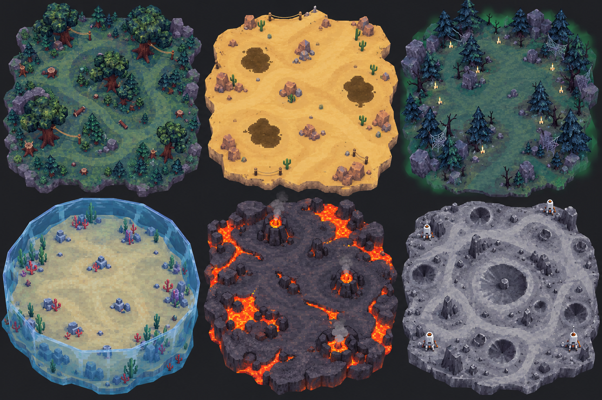

# Карты и материалы

[Главная страница](../../README.md) · [Презентация в браузере](slides/README.md)

Шесть биомов с отдельными страницами, крупными картинками и описаниями.

| № | Карта | Главная особенность |
| --- | --- | --- |
| 01 | [Глубокий лес](01-forest.md) | Зацепы за верёвки |
| 02 | [Бескрайние пески](02-desert.md) | Зыбучий грунт |
| 03 | [Призрачный лес](03-ghost.md) | Дух-усилитель |
| 04 | [Купол на дне](04-underwater.md) | Разрушение купола |
| 05 | [Вулкан](05-volcano.md) | Лава и гейзеры |
| 06 | [Луна](06-moon.md) | Низкая гравитация |

## Планировки

Схемы показывают характер маршрутов и расположение опасных зон. Масштаб условный.

[Боссы и переходы](world.md) · [Полный концепт-бук](CONCEPT-BOOK.md)
