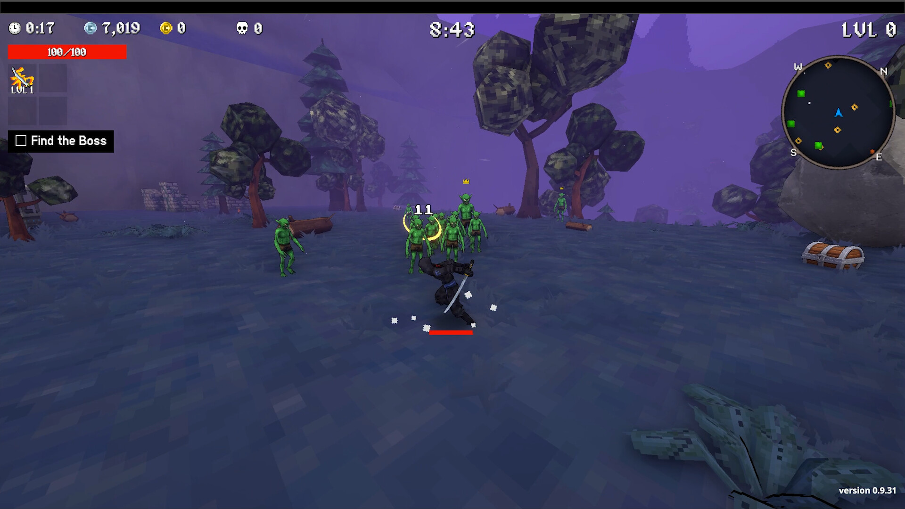
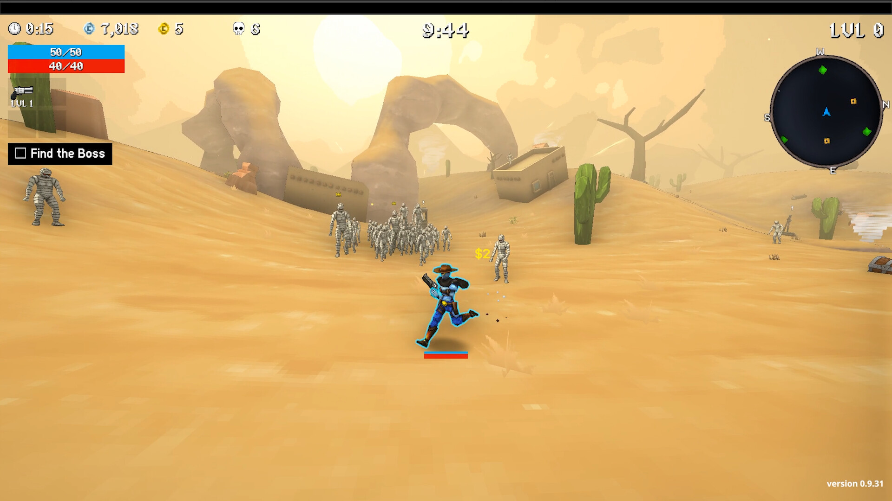
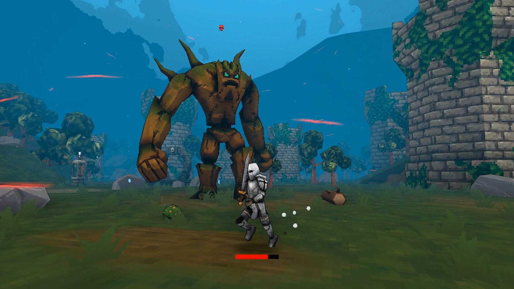

# Исследование стиля Megabonk для переделки v2

Этап 1: анализ оригинальных материалов. Генерация изображений на этом этапе не запускалась. Дата исследования: 23 октября 2026.

## Источники и пределы выводов

Основной источник — [официальная страница Megabonk в Steam](https://store.steampowered.com/app/3405340/Megabonk/). Шесть полных изображений получены из поля `data.screenshots` [Steam Store API](https://store.steampowered.com/api/appdetails?appids=3405340). Все шесть сохранены в оригинальном разрешении 1920 × 1080 и просмотрены через view_image в original detail.

Также обнаружен [официальный пресс-кит Megabonk](https://megabonk.itch.io/megabonk-presskit-release), в котором автор предлагает скриншоты и игровые материалы. Для настоящего визуального анализа достаточно уже полученных официальных изображений Steam; пресс-кит не скачивался и не используется для неподтверждённых выводов.

Важно различать: наблюдаемый вид изображения и внутреннюю реализацию рендера. Скриншоты позволяют уверенно описать текстурирование, геометрию, композицию и туман. Они не раскрывают точную внутреннюю render resolution, размер каждого атласа, алгоритм фильтрации, полигональный бюджет или настройки камеры. Такие числа ниже не выдумываются.

## Локальные референсы

| Файл | Содержимое | Пригодность |
| --- | --- | --- |
| [steam-official-0.jpg](references/steam-official-0.jpg) | Рыцарь и огромный древесный противник в лесу; руины, кроны, земля и голубая даль | Крупный план текстур и силуэтов; лесная среда. Композиция промо, камера ближе обычной |
| [steam-official-1.jpg](references/steam-official-1.jpg) | Крупный персонаж-обезьяна, грунт и деревья в глубине | Текстура персонажа, контуры, texture density. Крупный промокадр, не эталон игрового размера героя |
| [steam-official-2.jpg](references/steam-official-2.jpg) | Реальный gameplay пустыни с HUD: герой, мумии, дюны, кактусы, скальные арки | Лучший эталон пустынного грунта, открытой плотности, ракурса и масштаба |
| [steam-official-3.jpg](references/steam-official-3.jpg) | Скелет и скейтборд на сильно размытом фоне | Только формы и текстуры персонажа. Не использовать как эталон резкости окружения или камеры |
| [steam-official-4.jpg](references/steam-official-4.jpg) | Gameplay арены босса с красным небом и широкими платформами | Геометрия арен, pixelated VFX и масштаб героя |
| [steam-official-5.jpg](references/steam-official-5.jpg) | Реальный gameplay леса с HUD: герой, гоблины, деревья, камень, папоротник, сундук, фиолетовая даль | Главный эталон окружения, рабочей third-person камеры, масштаба и плотности |

Полные исходные URL каждого файла записаны в [steam-sources.json](references/steam-sources.json).

## Главный вывод

**Megabonk — ретро low-poly 3D с отчётливо низкорезолюционными пиксельными текстурами. Формулировка v1 «плоские цвета без текстур» неверна.**

Простота оригинала выражается в грубой геометрии, повторяемых моделях, простой постановке света и дешёвой на вид фактуре. При этом поверхности не стерильно однотонные. На грунте, листве, камнях, одежде и телах хорошо видны блочные цветовые пятна. Контуры объектов местами ступенчатые, а пиксельность текстур сохраняется в перспективе.

«Без реализма» в нашем задании не означает «милый гладкий набор игрушек». Нужна простая грубоватая игровая среда, в которой объекты выглядят как недорогие ретро 3D-ассеты, собранные в работающую арену.

## 1. Пикселизация и текстуры

На скринах 0, 1 и 5 кроны покрыты крупными неровными пиксельными пятнами нескольких близких цветов. На скринах 2 и 5 грунт содержит повторяемую низкорезолюционную фактуру с вытянутыми перспективой блоками. Это не абстрактное распределение цвета по полигонам: рисунок живёт внутри поверхности.

Броня рыцаря, листья и каменные стены тоже текстурированы. Штрихи и пятна укрупнены, края рисунка резкие. На отдельных персонажах и объектах видны тёмные линии по границам деталей.

Для v2:

- Вводить low-resolution pixel textures на грунт, кроны, кору, скалы и основных мобов.
- Держать текстуру грубой и ограниченной по палитре, без мелкой высокочастотной реалистичной фактуры.
- Сохранять видимые квадратные пиксельные элементы на крупном и среднем плане.
- Убирать фотореалистичные normal maps, сложную микрошероховатость и PBR-материалы.
- Не заменять весь кадр плоским 2D pixel art: перспектива, геометрия и объём остаются трёхмерными.
- Не накладывать равномерную мозаику поверх гладкого изображения как имитацию стиля: pixel texture должна помогать описывать материал.
- Не утверждать технически точный nearest-neighbor pipeline: это желаемый визуальный характер резких texels, а внутренний sampler по скриншоту не доказан.

## 2. Геометрия деревьев

На скрине 5 основные деревья имеют сравнительно тонкий простой ствол, несколько коротких ветвей и несколько округлых многогранных комков кроны. Сам силуэт простой, но комки не превращены в идеальные шары. Их объём создаётся грубой сеткой и пятнистой листвой. Позади также видны хвойные формы с ярусами.

Это существенное отличие от v1: там было много гладких гранёных массивов без текстуры, а стволы и корни местами выглядели как тщательно подготовленные декоративные фигурки.

Для глубокого леса можно увеличить стволы и закрыть небо по пользовательской идее, но строить их той же грубой ретро-логикой. Нельзя переносить типовой stock low-poly look: чистые треугольники, однотонные кроны, аккуратные толстые полигональные корни и studio AO.

Для призрачного леса исходный графический язык сохраняется. Меняются хвойный силуэт, палитра, паутина, свечи и туман. Никаких замков, построек и тыкв по пользовательскому заданию.

## 3. Камни, стены и грунт

Камни на скринах 0 и 5 — небольшое число крупных плоскостей с серой грубой текстурой. У крупного валуна нет множества красиво освещённых треугольных граней. Платформы на скрине 4 имеют простые вертикальные борта и слегка неровные края. Их поверхность грубо текстурирована.

Земля на скрине 5 — обширная цельная поверхность с повторяемым тёмным pixel pattern. На скрине 2 песок похож по принципу, но светлее и теплее. Рельеф образует широкие подъёмы, впадины и большие читаемые склоны.

Для v2:

- Крупные простые формы рельефа, мало деталей на силуэте.
- Длинные доступные беговые маршруты и большие видимые участки пола.
- Грубая повторяемая texture на грунте.
- Небольшой случайный декор и точки интереса, без ковров из папоротников и камушков.
- Не делать поверхность совершенно гладкой и однотонной.
- Не добавлять здания и руины в карты, где пользователь их запретил, только потому что они присутствуют в оригинальном лесу Megabonk.

## 4. Пропорции персонажей и мобов

На gameplay скринах 2 и 5 герои вытянутые, с небольшими головами и выраженными руками и ногами. На крупном скрине 0 рыцарь тоже не кубический и не чиби. Гоблины на скрине 5 грубые, несколько карикатурные, но не выглядят малышами с огромными глазами. Текстуры создают лицо, мышцы, детали одежды и различия материалов.

Смешной контекст и нарочито грубая эстетика оригинала не требуют превращать всех существ в милых круглых маскотов.

Для v2:

- Грубые игровые модели с обычными или слегка преувеличенными пропорциями.
- Нормальная небольшая голова на гуманоидном теле, длинные читаемые конечности.
- Небольшое количество пиксельных деталей для лица и материала.
- Для выбранной конкретной модели допустимы смешные детали, но не общее «cute chibi» направление.
- На игровом hero-кадре размер героя сопоставим с gameplay референсами, а не с крупными промокадрами персонажей.

## 5. Масштаб, камера и композиция

Лучшие gameplay эталоны — скрины 2 и 5. Герой расположен в нижней центральной части, камера стоит за ним и выше, смотрит вперёд и немного вниз. В кадре видны и ближний грунт, и дальние ориентиры, и значительная часть неба/дальнего фона. Это перспективная third-person камера, а не изометрия.

По скринам 2 и 5 герой занимает примерно одну шестую высоты кадра; это визуальная оценка композиции, не размер камеры или персонажа в движке. Он достаточно крупный для чтения позы, при этом основную площадь занимает доступная среда. На промокадрах 0 и 1 персонажи сняты ближе, поэтому их нельзя использовать как универсальную норму масштаба.

Для v2:

- Основной hero — рабочий игровой ракурс за персонажем.
- Горизонт не обязан быть симметричным или идеально центрированным.
- Не делать крошечного героя на эпической открытке.
- Не делать героя из Minecraft с квадратной головой.
- Не ставить камеру на уровень земли для драматического монумента.
- Не использовать ортографическую «доску настольной игры» как общий вид карты.
- HUD можно убрать для чистоты презентации, но камера и масштаб должны оставаться игровыми.

## 6. Цвет, туман и свет

Туман в оригинале заметный и цветной. Лесные изображения 0 и 1 используют голубую даль, скрин 5 — фиолетовую. Силуэты деревьев и рельефа постепенно уходят в близкий к цвету неба тон, создавая глубину без сложной детализации.

В пустыне скрин 2 светлый и тёплый, с песочной атмосферной дымкой. На скрине 4 боссовая арена имеет красное небо и сильное однотонное настроение. Поэтому «обычный игровой свет» не означает отсутствие атмосферного цвета.

Для v2:

- Простая заметная цветная дистанционная дымка.
- Дальние объекты теряют контраст и фактуру.
- Ближние поверхности сохраняют грубую текстуру и достаточную читаемость.
- Умеренный простой свет, без глянцевого PBR, studio lighting, аккуратной мягкой предметной тени и high-end GI.
- Не использовать кинематографический volumetric fog с красивыми лучами сквозь листву.
- Не делать всё бесцветным: оригинал допускает сильные синий, фиолетовый, песочный, красный режимы.
- Яркие эффекты присутствуют в оригинале, но демонстрационный кадр окружения не нужно перегружать ими.

## 7. Плотность окружения

В основном игровом лесном скрине 5 много открытого пола. Деревья стоят отдельно или небольшими группами, между ними можно бегать. На земле — отдельные бревна, низкая растительность, сундук, камни. Пространство выглядит функциональным и немного пустым, а не тщательно украшенной диорамой.

В пустыне скрина 2 декора ещё меньше: отдельные кактусы, редкие сухие деревья, камни и дальние арки. Рельеф делает больше визуальной работы, чем детали.

Для v2:

- Несколько повторяемых объектов читаемых типов.
- Большинство ближнего поля остаётся свободным.
- На средней дистанции объекты помогают ориентироваться и создают парраллакс.
- Убирать декоративные кольца из объектов вокруг игрока и симметричную постановку декора.
- Не рассыпать равномерно по всей карте сотни уникальных красивых предметов.

## Ошибки v1

Это разбор ранее сделанных материалов как результата, а не использование их в качестве доказательства стиля оригинала.

1. **Неправильная базовая инструкция.** «Flat untextured colors» исключила важнейшую часть оригинальной графики — pixel textures.
2. **Слишком чистый stock low-poly.** Крупные красивые плоскости, ровные цвета и аккуратные тени дали типовой современный low-poly pack вместо грубоватого ретро.
3. **Слишком милые мобы.** Огромные глаза, округлые тела и детские пропорции приблизили доски к toy characters.
4. **Кубический герой.** Слишком блочный adventurer не соответствует вытянутым текстурированным персонажам gameplay референсов.
5. **Предметная подача декора.** Мягкая студийная тень и серый фон сами по себе удобны для каталога, но не доказывают пригодность ассета в игровом свете.
6. **Избыточная декоративность.** Большие аккуратные папоротники, сложные корни и слишком тщательно составленные группы создают ощущение сцены для рендера.
7. **Недостаток характерного texture noise.** Земля и листва были слишком ровными и стерильными.
8. **Избыточная уверенность в слове Megabonk.** Упоминание названия игры в prompt без настоящих оригинальных референсов не обеспечило нужного графического языка.

## Точные constraints для v2

### Обязательная положительная спецификация

- Retro textured low-poly 3D game screenshot aesthetic.
- Visible coarse low-resolution pixel textures on terrain, foliage, rock and enemies.
- Sparse repeated game props, broad traversable ground, rough simple geometry.
- Normal/slightly exaggerated humanoid proportions; small head, readable long limbs.
- Working perspective third-person camera behind and above the player.
- Strong simple biome-colored distance fog; plain inexpensive-looking game lighting.
- Pixelated texture detail within actual 3D surfaces.
- In-game scale and environment proportions guided by official Steam screenshots 2 and 5.
- User biome specifics take priority over objects borrowed from original game.

### Запреты

- No photorealism, no PBR showcase, no cinematic matte painting.
- No smooth flat untextured toy aesthetic.
- No cute chibi, no giant mascot eyes by default.
- No Minecraft cube-head adventurer.
- No polished stock flat-shaded low-poly asset pack.
- No high-frequency realistic material detail.
- No detailed diorama gardening, no decorative clutter carpets.
- No studio product lighting as the scene style.
- No fake universal 2D mosaic layer.
- No arbitrary buildings/pumpkins/pyramids where user forbids them.

### Правило приёмки

До полной партии сделать один пробный игровой вид и одну маленькую проверку декора. Сравнивать рядом с оригинальным скрином 5 по пяти вопросам: есть ли coarse pixel textures, похожа ли камера, похож ли масштаб героя, достаточно ли свободного пола, ушла ли гладкая игрушечность. Если нет — менять стиль до генерации остальных биомов. Это предложение workflow, не утверждение, что такой этап уже выполнен.

## Готовность этапа

Исследование сохранено. Официальные референсы скачаны и просмотрены. Новые изображения не генерировались. Этап 2 ожидает команды родительского агента.
