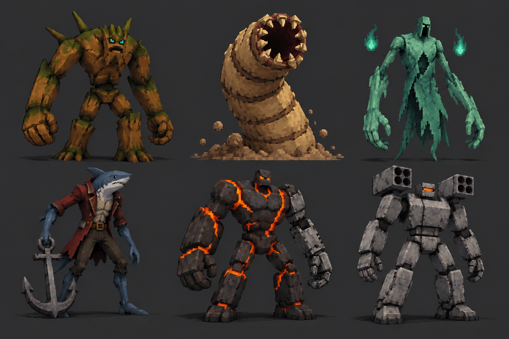
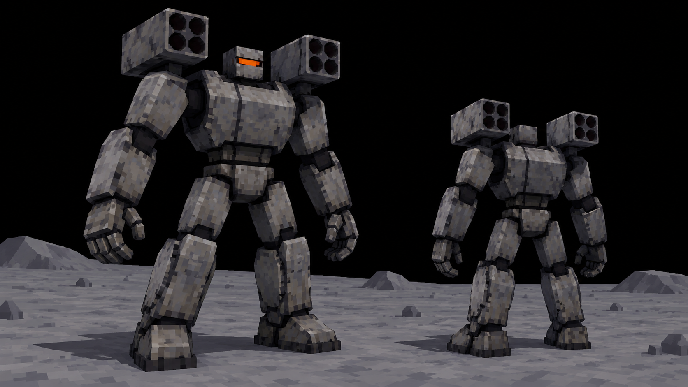

# Боссы, переходы и устройство мира

[Все карты](../../README.md) · [Слайды](slides/README.md)

## Боссы и кульминация последовательности

Линейка боссов — **предложения для наших карт**. Они используют механику своего биома, но не требуют сложной новой системы управления. Общий принцип: крупный силуэт, читаемая подготовка атаки, опасное действие и окно для ответа. На доске — направления образов; точная последовательность атак требует прототипа.

### Лунный босс с двумя плечевыми ракетницами

У босса **две ракетницы на плечах**, отдельная на каждом плече. Это основной признак силуэта. Руки остаются свободными и различимыми, голова небольшая. Корпус собран из простых крупных частей; детализация передаётся грубой низкорезолюционной текстурой. Без множества пластин, проводов, украшений и глянца.

Предлагаемый цикл атаки:

1. Плечевые блоки поворачиваются и дают короткий читаемый сигнал подготовки.
2. Простые ракеты выходят из блоков; след короткий и ступенчатый.
3. Отмеченные зоны падения заставляют учитывать длинный лунный прыжок.
4. После залпа есть окно, в котором удобно атаковать и сменить сторону кратера.

Сигнал подготовки, полёт и отметка на земле должны читаться вместе. Точные длительности, урон и количество ракет не фиксируем. Это авторский концепт; такой босс не приписывается оригинальной игре.

## Общий пул взаимодействий сверх шести основных

Это каталог возможного наполнения. Все типы не обязаны появляться на каждой карте одновременно. Базовую функцию узнают по общему силуэту и интерфейсу; биом меняет материал и цвет. Детальные первоисточники и разночтения перечислены в [исследовании взаимодействий](research/interactions.md).

| Тип | Что даёт игровому циклу | Как показать в наших биомах |
| --- | --- | --- |
| Pots | Разбиваемые сосуды с ресурсами | Глиняный горшок, морская амфора, обожжённый сосуд, простая лунная капсула |
| Challenge Shrine | Активируемая группа сильных врагов с наградой за победу | Узнаваемые скрещённые клинки у небольшого простого корпуса |
| Greed Shrine | Золото в обмен на повышение сложности | Низкий идол с черепом/рогами и явным предупреждением в интерфейсе |
| Boss Curse | Дополнительные копии боссов и связанные награды в рамках исходных правил | Тёмный идол, горячий маяк или другой простой тревожный корпус |
| Shady Guy | Выбор покупки одного предмета; после покупки продавец уходит | Путник, призрачный торговец, рыба-торговец, торговец в шлеме |
| Free / Gold Chest | Бесплатная награда | Узнаваемый сундук с отдельным цветовым акцентом |
| Golden Charge | Зарядка с предложениями высокой редкости | Тот же простой Charge-силуэт с золотым акцентом |
| Golden Moai | Вариант выбора награды высокой редкости | Та же голова с одним золотым акцентом |
| Boomboxes | Исследовательское открытие, связанное с музыкой | Небольшой узнаваемый проигрыватель; размещение адресное |
| Ключ и клетка | Специальное исследовательское открытие | Отдельная постановочная находка, не обязательная клетка в каждом биоме |
| Suspicious Bush / особые встречи | Секретный противник или событие | Объект, уместный для конкретной карты; сначала определить условия |
| Tumbleweed | Разбиваемый катящийся ресурс и отдельные открытия | Простой пыльный клубок в пустыне |

Рескин не даёт права менять функцию молча. Charge улучшает характеристики и не становится обязательным захватом всех точек ради портала. Moai даёт выбор, не слот-машину. Succ собирает существовавший на карте опыт разовым действием, не превращается в постоянный магнит. Microwave требует золото и случайный другой предмет той же редкости; доступные применения показываются в интерфейсе.

**Campfire отдельно:** в изученной системе это предмет, создающий лечащий костёр при остановке. Декоративная свеча, костёр или лампа на карте сама по себе не объявляется бесплатной постоянной точкой лечения.

Использованное состояние в таблицах биомов — наше предложение визуальной обратной связи, не утверждение о точной анимации оригинала. Для Charge базовые правила выхода из радиуса и связей с предметами сохраняются. Для Microwave не фиксируем универсальное число использований. Точную цену и исключения для проклятий боссов сверяем с реализацией исходного цикла.

## Переходы между биомами

| Связка | Короткая визуальная подготовка |
| --- | --- |
| Лес → пустыня | Деревья редеют, трава сохнет, на земле появляется песок |
| Пустыня → призрачный лес | Засохшие сосны, серо-зелёный грунт и один зелёный огонёк |
| Призрачный лес → купол | Влажная земля, ракушки и водные отблески |
| Купол → вулкан | Пузырящиеся горячие трещины, тёмный базальт |
| Вулкан → Луна | Оплавленные части узнаваемых роботов |
| Луна → финал | Повторяющийся сигнал приводит к предполагаемому источнику; финал обсуждается |

Промежуточные смешанные карты пока не обязательны. В конце биома достаточно небольшой группы признаков следующего. Если позже нужен отдельный переходный бой, его можно собрать из уже созданных элементов, но всё равно потребуются планировка и проверка волн.

Окаменевшая раковина в пустынном декоре остаётся редкой находкой, а не указанием на ближайшую подводную карту. Огромная тень за куполом создаёт масштаб; её личность не закреплена.

## Общая отсылка и устройство мира

Предлагаем один сквозной мотив: **квадратный оранжевый сигнал в маленьком предмете каждой карты**. Сначала он выглядит случайной находкой. В вулкане возникает узнаваемый глаз повреждённого робота. На Луне этот же мотив встречается на целых роботах и приборах. Часть таких маленьких предметов ещё потребует отдельного дизайна; не выдаём их за уже показанные позиции на всех досках.

Финальная локация, происхождение сигнала и окончательная роль финального босса остаются открытыми. Смотритель кратера — предложенный босс шестого биома. Его две плечевые ракетницы закреплены как требование визуального дизайна.

Идея неровной карты в воздухе с видимым снизу следующим биомом сохраняется как вариант общей архитектуры. Не переносим обрыв автоматически на купол, вулкан и Луну. Сначала нужно выбрать объяснение пространства и проверить камеру у края. У каждой карты уже описана самостоятельная понятная граница.

## Приоритеты реализации

1. Проверить масштаб персонажа, простоту форм, низкорезолюционные текстуры и игровую камеру в движении.
2. Собрать свободную арену и коллизии крупных объектов, затем добавить редкий мелкий декор.
3. Восстановить общий цикл Chest, Charge, Moai, Succ, Microwave и Portal.
4. Прототипировать одну авторскую особенность биома и её четыре фазы.
5. Добавить мобов по разным ролям и проверить, остаются ли безопасные маршруты.
6. Проверить босса, переход и короткую визуальную отсылку.
7. Настроить урон, время, цены и частоты по игре. Концепт не фиксирует точные балансные числа.

## Состав комплекта

В книге встроены **26 новых изображений v2**: четыре на каждый из шести биомов, общий лист предложений боссов и отдельный лунный босс. Это концепты и референсы для реализации, не готовые 3D-модели и не скриншоты существующих пользовательских карт.

Каталоги включают **72 позиции декора, 36 мобов и 36 рескинов основных интерактивов**. Набор шести функций повторяется для удобства узнавания. Исходные названия находятся в трёх файлах `content-*.json`, точные задания генерации — в `prompts`. Этот концепт-бук задаёт сводный порядок переходов.
